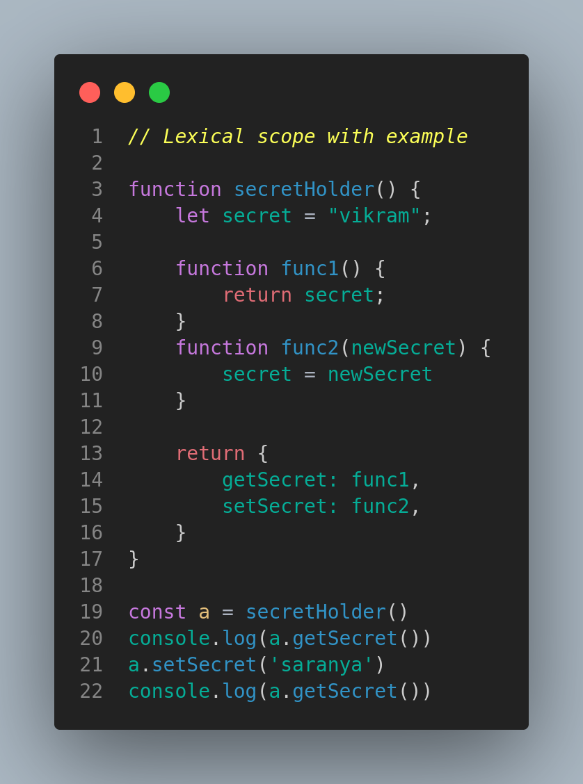

## 1) Variable Declarations: `var`, `let`, and `const`

JavaScript provides three ways to declare variables:

- `var`: The old way, function-scoped.
- `let`: Introduced in ES6, block-scoped.
- `const`: Also block-scoped, but cannot be reassigned.

### Syntax Examples:

```javascript
var name = "John";
let age = 25;
const country = "India";
```

### Explanation:
- **`var`** has been around since the beginning of JavaScript but has confusing behavior due to hoisting and function scope.
- **`let`** solves these problems by being block-scoped.
- **`const`** is just like `let`, but it doesn’t allow reassignment.

---

## 2) Hoisting in JavaScript

**Hoisting** is JavaScript's behavior of **moving variable and function declarations to the top** of their scope **before code execution**.

However:
- Only **declarations** are hoisted, **not initializations**.
- Different behaviors apply to `var`, `let`, `const`, and functions.

### 🔹 Hoisting with `var`

Variables declared with `var` are:
- Hoisted to the top of the function or global scope
- Automatically initialized as `undefined`

#### 🔸 Example:

```javascript
console.log(a); // undefined
var a = 5;
console.log(a); // 5
```

### 🔹 Full Hoisting Examples

```javascript
"use strict";

// Function declaration is hoisted
greet(); // ✅ Works

function greet() {
  console.log("Hello!");
}

// var is hoisted but undefined
console.log(a); // ✅ undefined
var a = 5;
console.log(a); // ✅ 5

// let and const are hoisted but not initialized
try {
  console.log(b); // ❌ ReferenceError
} catch (e) {
  console.error("Error accessing b:", e.message);
}
let b = 10;

try {
  console.log(c); // ❌ ReferenceError
} catch (e) {
  console.error("Error accessing c:", e.message);
}
const c = 20;

// Function expression is not hoisted as a function
try {
  sayHi(); // ❌ TypeError
} catch (e) {
  console.error("Error calling sayHi:", e.message);
}
var sayHi = function () {
  console.log("Hi there!");
};
```

## 3) Variable Naming Rules in JavaScript

Variable names in JavaScript must follow specific rules to be valid and avoid syntax errors.


### ✅ Valid Rules

1. **Can contain letters, digits, underscores (`_`), and dollar signs (`$`)**
2. **Must begin with a letter, underscore (`_`), or dollar sign (`$`)**
3. **Cannot start with a number**
4. **Cannot be a reserved keyword (like `var`, `let`, `class`, `return`, etc.)**
5. **JavaScript is case-sensitive (`myVar` and `myvar` are different)**

---

### 🔸 Examples of Valid Names

```javascript
let name;
let _name;
let $name;
let name123;
let firstName;
```

---

### ❌ Examples of Invalid Names

```javascript
let 123name;     // ❌ Invalid: starts with a number
let let;         // ❌ Invalid: "let" is a reserved keyword
let my-name;     // ❌ Invalid: hyphens are not allowed
```

### Best Practices

* Use **camelCase** for variable names: `userName`, `totalPrice`
* Make variable names **meaningful**: `count` is better than `c`
* Avoid starting with `_` or `$` unless it has a specific purpose (e.g., private variables or jQuery)

## 4) Variable Scope in JavaScript

**Scope** determines the **accessibility (visibility)** of variables. JavaScript has the following types of scope:

---

### 🔹 1. Global Scope

* A variable declared **outside of any function or block** is in the global scope.
* Accessible **from anywhere** in the code.

```javascript
let globalVar = "I'm global";

function showGlobal() {
  console.log(globalVar); // ✅ Accessible
}

showGlobal();
console.log(globalVar); // ✅ Accessible
```

---

### 🔹 2. Function Scope

* Variables declared with `var` inside a function are function-scoped.
* **Accessible only within that function**.

```javascript
function greet() {
  var message = "Hello!";
  console.log(message); // ✅ Accessible
}

greet();
console.log(message); // ❌ Error: message is not defined
```

---

### 🔹 3. Block Scope

* Variables declared with `let` and `const` inside a block (`{}`) are block-scoped.
* Accessible **only within that block**.

```javascript
{
  let x = 10;
  const y = 20;
  console.log(x, y); // ✅ Accessible inside the block
}

console.log(x); // ❌ Error: x is not defined
console.log(y); // ❌ Error: y is not defined
```

---

### 🔹 4. Lexical Scope (Closures)

* Functions have access to the **scope in which they were defined**, not the scope in which they are called.

```javascript
function outer() {
  let outerVar = "I'm outer";
  function inner() {
    console.log(outerVar); // ✅ Accessing outer function's variable
  }
  return inner;
}

const callInner = outer();
callInner(); // ✅ Still has access to outerVar
```

### Summary Table

| Scope Type | Declared With   | Accessible From                       |
| ---------- | --------------- | ------------------------------------- |
| Global     | var, let, const | Anywhere                              |
| Function   | var             | Inside the function only              |
| Block      | let, const      | Inside the block only                 |
| Lexical    | Closures        | Defined at declaration, not execution |


## 5) Closures in JavaScript

A **closure** is created when a function is defined **inside another function**, and the inner function **remembers variables** from the outer function—even after the outer function has finished execution.

### 🔍 Definition

> A closure is a combination of a function and the **lexical environment** within which it was declared.

---

### ✅ Basic Example

```javascript
function outer() {
  let name = "Vikram";

  function inner() {
    console.log("Hello, " + name);
  }

  return inner;
}

const greet = outer(); 
greet(); // Output: Hello, Vikram
```

#### 💡 Explanation:

* `outer()` returns the `inner()` function.
* Even after `outer()` completes, the `inner()` function remembers the `name` variable because of closure.

---

### ✅ Counter Example

```javascript
function counter() {
  let count = 0;

  return function () {
    count++;
    console.log("Count:", count);
  };
}

const increment = counter();
increment(); // Count: 1
increment(); // Count: 2

const anotherIncrement = counter();
anotherIncrement(); // Count: 1
```

* Each `counter()` call creates a new closure with its own `count` variable.

---

### 🔐 Data Privacy Use Case

Closures are useful for **data encapsulation**:

```javascript
function secretHolder() {
  let secret = "12345";

  return {
    getSecret: () => secret,
    setSecret: (newSecret) => {
      secret = newSecret;
    },
  };
}

const mySecret = secretHolder();
console.log(mySecret.getSecret()); // 12345
mySecret.setSecret("abcde");
console.log(mySecret.getSecret()); // abcde
```



### 📌 Summary Table

| Feature             | Description                                   |
| ------------------- | --------------------------------------------- |
| Closure             | Function + its surrounding scope              |
| Remembers variables | Even after outer function finishes execution  |
| Use Cases           | Data hiding, private state, factory functions |

---

Let me know if you'd like this merged with earlier content in a single `.md` file or if you're ready to move on to the next topic like:

* Variable Shadowing
* Temporal Dead Zone (TDZ)
* `let`/`const` in loops
* Function Expressions vs Declarations

Which one should we go with next?

