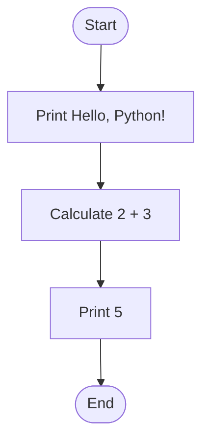

# 1. Introduction to Python

[Back to all Python lessons](../README.md)

Python is a programming language used to automate tasks, build applications,
and work with data. A Python file ends in `.py`. Python runs the statements in
this example from top to bottom. `print()` displays a value on the screen.

## Your first program

```python
print("Hello, Python!")
print(2 + 3)
```

Output:

```text
Hello, Python!
5
```

The text inside quotes is a **string**. `2 + 3` is an expression that Python
calculates before printing its result.

## Run the example

Install Python 3.10 or newer. Open a terminal in the workspace folder that
contains `js` and `python`, then run:

```sh
python3 python/1.introduction/index.py
```

On Windows, you can use:

```sh
py python/1.introduction/index.py
```

Both commands run the program above and produce the same output. Other lessons
also have an `index.py`; replace the folder name to run one of them.

## Flow diagram



## Common mistake

`print(Hello)` treats `Hello` as a variable name. To print text, include quotes:
`print("Hello")`.

## Extended lesson

**Learning goals:** Run code, distinguish expressions from statements, and explain indentation and comments.

An expression produces a value, such as `2 + 3`. A statement performs an action, such as assigning that value to a name. A program combines both. The interpreter evaluates expressions when their containing statement runs.

In the interactive interpreter, typing an expression displays its result. In a script, use `print()` when you want visible output. The `>>>` and `...` characters in interactive examples are prompts, not part of the program. A `#` comment explains intent and is ignored during execution. Indentation groups statements into blocks; use four spaces consistently.

### Expressions and statements

The addition is evaluated first. Assignment stores the result, and print displays it.

```python
total = 4 + 6
print(total)
print(total * 2)
```

Output:

```text
10
20
```

### A block contains related steps

Both indented lines belong to the condition. The last line runs after the block.

```python
if True:
    print("Inside")
    print("Still inside")
print("Outside")
```

Output:

```text
Inside
Still inside
Outside
```

### Comments explain why

Choose comments that explain a decision; clear names already explain many actions.

```python
# A pair needs two tickets.
tickets_per_pair = 2
print(tickets_per_pair * 3)
```

Output:

```text
6
```

## Practice and worked answer

1. Predict the output of `print(3 + 2 * 4)` before running it.
2. Print a greeting and then the number of minutes in two hours.

Try these before reading the answer.

<details>
<summary>Show the explanation and one solution</summary>

Multiplication happens first, so the first result is `11`. The second calculation is `2 * 60`, which is `120`.

### One solution

This example runs independently.

```python
print("Hello, learner!")
print(2 * 60)
```

Output:

```text
Hello, learner!
120
```

</details>
