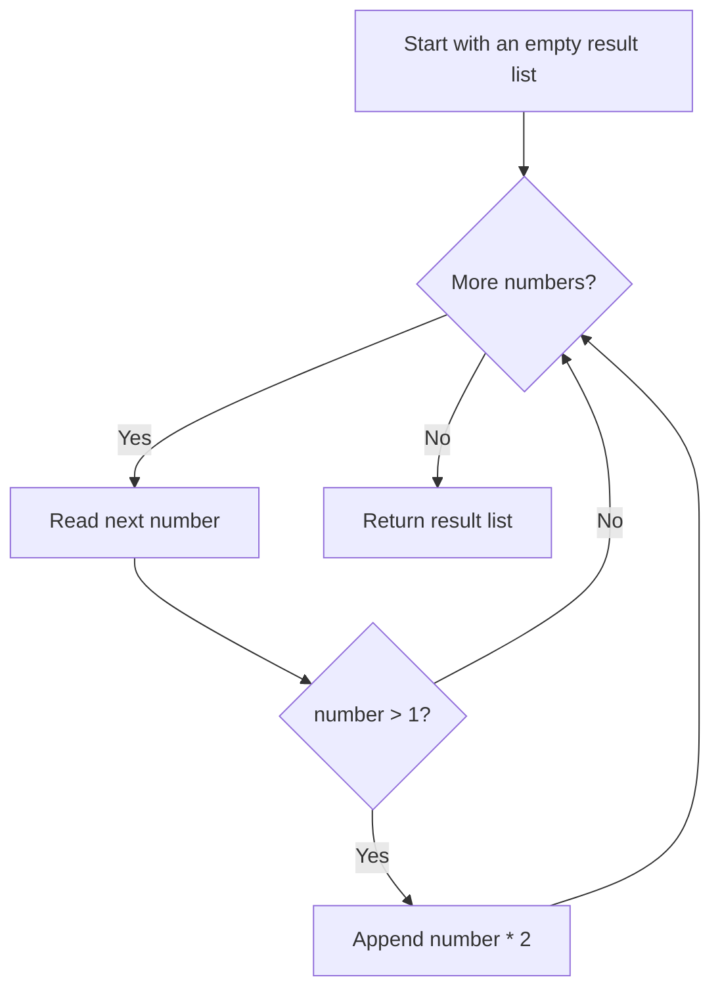

# 10. Strings and comprehensions

[Back to Python topics](../README.md)

A string stores text. Indexing selects one item; slicing selects part of a sequence.
A comprehension builds a collection from an iterable using a short expression.

## Example: clean text

String methods return new strings because strings are immutable.

```python
name = "  Maya  "
clean = name.strip()
print(clean.upper())
print(f"Hello, {clean}!")
```

Output:

```text
MAYA
Hello, Maya!
```

Run `index.py` in this folder to try this example.

## Indexing and slicing

Indexes start at `0`. A slice `start:stop` excludes `stop`. Negative indexes count
from the end.

```python
word = "Python"
print(word[0])
print(word[-1])
print(word[1:4])
```

Output:

```text
P
n
yth
```

## List comprehension

Read `[number * 2 for number in numbers if number > 1]` as: for each number,
keep it if it is greater than `1`, then put its doubled value in a new list.

```python
numbers = [1, 2, 3]
doubled = [number * 2 for number in numbers if number > 1]
print(doubled)
```

Output:

```text
[4, 6]
```

## Flow diagram



## Dictionary comprehension

```python
squares = {number: number ** 2 for number in [1, 2, 3]}
print(squares)
```

Output:

```text
{1: 1, 2: 4, 3: 9}
```

**Common mistake:** assigning `word[0] = "J"`. Strings cannot be changed in place;
build a new string instead. Prefer a normal loop when a comprehension becomes hard to read.

## Extended lesson

**Learning goals:** Transform text and collections without hiding the order of operations.

Text processing often follows three steps: normalize input, split it into useful parts, then format output. strip removes whitespace from the ends; it does not remove spaces inside the text. split without an argument treats runs of whitespace as separators. join builds one string from an iterable of strings.

A comprehension creates a new collection. Its expression runs for each item that passes the optional filter. Prefer a normal loop when there are side effects or several decisions. Slices accept a step, and omitted bounds use the sequence's ends. Out-of-range slices are allowed, but a single invalid index raises IndexError.

### Split, normalize, and join

Each word is converted independently before joining.

```python
words = "  red   BLUE ".split()
print(words)
print(", ".join(word.lower() for word in words))
```

Output:

```text
['red', 'BLUE']
red, blue
```

### Use a slice step

A negative step visits the sequence in reverse order.

```python
word = "Python"
print(word[::2])
print(word[::-1])
```

Output:

```text
Pto
nohtyP
```

### Format numbers for display

Formatting changes the text representation; it does not change the numeric object.

```python
price = 12.5
print(f"Price: {price:.2f}")
print(f"Items: {1200:,}")
```

Output:

```text
Price: 12.50
Items: 1,200
```

### Filter a collection

The result is a new list; the input remains usable.

```python
values = [-2, 0, 3, 5]
positive_squares = [value ** 2 for value in values if value > 0]
print(positive_squares)
```

Output:

```text
[9, 25]
```

## Practice and worked answer

1. Normalize `"  PYTHON  "` to lowercase without surrounding spaces.
2. Build the squares of only the even values from `[1, 2, 3, 4]`.

Try these before reading the answer.

<details>
<summary>Show the explanation and one solution</summary>

Apply strip then lower for the text. Put the even-number condition after the comprehension's for clause.

### One solution

This example runs independently.

```python
print("  PYTHON  ".strip().lower())
print([n ** 2 for n in [1, 2, 3, 4] if n % 2 == 0])
```

Output:

```text
python
[4, 16]
```

</details>
