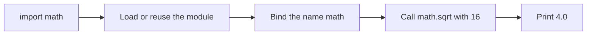

# 11. Modules and packages

[Back to Python topics](../README.md)

A **module** is a unit of reusable Python code, often a `.py` file. A **package**
groups modules under a shared name. `import` makes code from a module available.
The standard library comes with Python; third-party packages are installed separately.

## Example: import a standard library module

```python
import math

print(math.sqrt(16))
```

Output:

```text
4.0
```

Run `index.py` in this folder to try this example.

## Flow diagram



## Import a specific name

```python
from math import ceil

print(ceil(2.3))
```

Output:

```text
3
```

## Your own modules

If a folder contains `helpers.py` and `app.py`, code in `app.py` can use
`import helpers` when that folder is on Python's module search path. A regular
package usually has an `__init__.py` file; namespace packages can omit it.

## Virtual environments

A virtual environment keeps a project's installed packages separate. These commands
are optional setup; all lessons here use only the standard library.

```bash
python3 -m venv .venv
source .venv/bin/activate
python -m pip --version
```

On Windows, create the environment with `py -m venv .venv` and activate it in
PowerShell with `.venv\Scripts\Activate.ps1`. Run `deactivate` to leave it.

**Common mistake:** naming your own file `math.py` or `json.py`. It may hide the
standard library module you intended to import.

## Extended lesson

**Learning goals:** Understand import binding, module caching, package layout, and the active interpreter.

Import has two jobs: find and initialize a module if needed, then bind a name in the importing code. Python normally reuses modules already in sys.modules within the same process. Code at module level runs during initialization, so imports should avoid unnecessary work or interactive prompts.

Use clear module responsibilities, such as parsing.py for input conversion and reports.py for presentation. Circular imports can expose partially initialized modules; move genuinely shared definitions into a third module or reconsider the dependency direction. Prefer running package entry points with `python -m package.module` so Python understands their package context.

### Alias an imported module

An alias changes the local name used to access the same module.

```python
import math as maths
print(maths.isqrt(17))
```

Output:

```text
4
```

### Observe module reuse

Both import statements retrieve the same cached module in this process.

```python
import math
import importlib
same_module = importlib.import_module("math")
print(same_module is math)
```

Output:

```text
True
```

### Inspect a function's origin

This helps identify which module defines an imported function.

```python
from pathlib import Path
print(Path.__module__)
```

Output:

```text
pathlib
```

## Practice and worked answer

1. Explain why naming your file random.py can break `import random`.
2. Import only factorial from math and calculate 5 factorial.

Try these before reading the answer.

<details>
<summary>Show the explanation and one solution</summary>

A local module can shadow the standard-library module during module search.

### One solution

This example runs independently.

```python
from math import factorial
print(factorial(5))
```

Output:

```text
120
```

</details>
