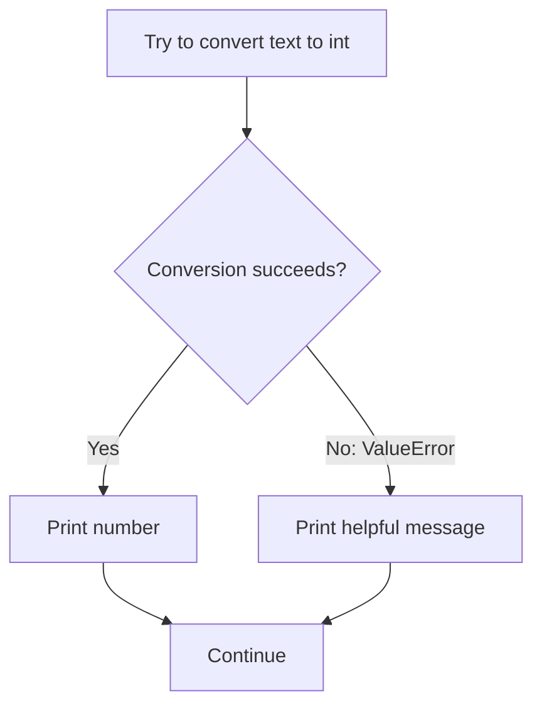

# 12. Errors and exceptions

[Back to Python topics](../README.md)

An exception reports a problem while code runs. `try` runs code that may fail;
`except` handles a specific kind of failure.

## Example: handle an invalid number

```python
text = "hello"
try:
    number = int(text)
    print(number)
except ValueError:
    print("Enter a whole number")
```

Output:

```text
Enter a whole number
```

`int("hello")` raises `ValueError`, so Python skips `print(number)` and runs the
matching handler. Run `index.py` in this folder to try it.

## Flow diagram



## else and finally

`else` runs when the `try` block completes without an exception. `finally` runs
when leaving the statement during normal execution or exception handling; it is
useful for cleanup.

```python
try:
    result = 6 / 2
except ZeroDivisionError:
    print("Cannot divide by zero")
else:
    print(result)
finally:
    print("Finished")
```

Output:

```text
3.0
Finished
```

Use `raise ValueError("message")` when your function receives an invalid value.
An exception without a matching handler travels to the caller and may stop the program.

**Common mistake:** using a bare `except:` to hide every failure. Catch the
specific exception you can handle, and keep the `try` block small.

## Extended lesson

**Learning goals:** Separate validation, recovery, cleanup, and programmer errors.

An exception interrupts the current operation and searches outward for a matching handler. Catch an error where you can make a meaningful decision: retry a temporary failure, report invalid input, or add context before propagating it. Catching everything and continuing may leave the program in an invalid state.

Use raise for invalid inputs to your function. Use finally or a context manager for cleanup. Do not return from finally just to provide a default: it can replace a previous return value or suppress an exception. Assertions describe internal assumptions; Python may remove them with optimization, so they are not input validation.

### Validate a function argument

Raise a descriptive exception before performing work with an invalid value.

```python
def divide(total, count):
    if count <= 0:
        raise ValueError("count must be positive")
    return total / count

try:
    divide(10, 0)
except ValueError as error:
    print(error)
```

Output:

```text
count must be positive
```

### Handle different failure categories

Catch only the errors this small operation is expected to produce.

```python
values = {"age": "unknown"}
try:
    print(int(values["age"]))
except KeyError:
    print("Missing age")
except ValueError:
    print("Age must be digits")
```

Output:

```text
Age must be digits
```

### Successful code skips the handler

The else block expresses work that depends on a successful try block.

```python
try:
    value = int("7")
except ValueError:
    print("Invalid")
else:
    print(value * 2)
```

Output:

```text
14
```

## Practice and worked answer

1. Explain the difference between TypeError and ValueError.
2. Catch division by zero and display a short message.

Try these before reading the answer.

<details>
<summary>Show the explanation and one solution</summary>

TypeError often means an operation received an unsupported kind of object; ValueError means an otherwise acceptable type has an unacceptable value.

### One solution

This example runs independently.

```python
try:
    print(1 / 0)
except ZeroDivisionError:
    print("Choose a nonzero divisor")
```

Output:

```text
Choose a nonzero divisor
```

</details>
