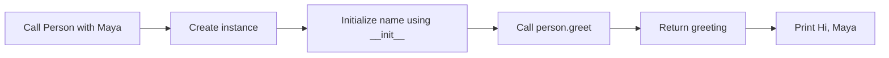

# 14. Classes and objects

[Back to Python topics](../README.md)

A **class** describes a kind of object. An **object** is an instance of that class.
Attributes hold data; methods define behavior.

## Example: a person with a name

```python
class Person:
    def __init__(self, name):
        self.name = name

    def greet(self):
        return f"Hi, {self.name}"

person = Person("Maya")
print(person.greet())
```

Output:

```text
Hi, Maya
```

- `Person("Maya")` creates an instance; `__init__` initializes its attributes.
- `self` refers to the instance receiving the method call.
- `person.name` belongs to this instance.
- Calling `person.greet()` passes the instance to the method automatically.

Run `index.py` in this folder to try this example.

## Flow diagram



## Each instance can hold different data

This example runs independently of the first one.

```python
class Box:
    def __init__(self, value):
        self.value = value

first = Box(1)
second = Box(2)
print(first.value, second.value)
```

Output:

```text
1 2
```

**Common mistake:** forgetting `self` in an instance method definition. Another
is placing a mutable list on the class when each instance needs its own list;
create it in `__init__` instead.

Continue with [inheritance, properties, and dataclasses](../Advanced%20concepts/3-object-oriented-python/README.md).

## Extended lesson

**Learning goals:** Separate instance state from class state and choose methods according to their purpose.

An instance attribute belongs to one object. A class attribute is found through the class and may be shared across instances. Use instance attributes for mutable per-object data. An instance method receives self; a class method receives cls and is useful for alternative constructors; a static method gets no automatic instance or class argument.

Encapsulation means exposing a useful interface and protecting invariants, not simply adding underscores. A leading underscore marks an implementation detail by convention. Prefer composition when an object has a collaborator, and inheritance when a subtype can honor the parent's contract. Not every group of functions needs a class.

### Keep each object's list separate

Creating the list inside __init__ gives every instance its own list.

```python
class Basket:
    def __init__(self):
        self.items = []

first, second = Basket(), Basket()
first.items.append("apple")
print(first.items)
print(second.items)
```

Output:

```text
['apple']
[]
```

### Offer an alternative constructor

The class method can transform external input before normal construction.

```python
class User:
    def __init__(self, name):
        self.name = name
    @classmethod
    def from_text(cls, text):
        return cls(text.strip())

print(User.from_text(" Maya ").name)
```

Output:

```text
Maya
```

### Prefer a useful behavior method

A method changes the object's own state through a small interface.

```python
class Counter:
    def __init__(self):
        self.value = 0
    def increment(self):
        self.value += 1

counter = Counter()
counter.increment()
print(counter.value)
```

Output:

```text
1
```

## Practice and worked answer

1. Explain why a mutable class-level list can surprise users of multiple instances.
2. Create a Rectangle with width and height and an area method.

Try these before reading the answer.

<details>
<summary>Show the explanation and one solution</summary>

Instances may all find and mutate the same class-level list. Per-instance state belongs in __init__.

### One solution

This example runs independently.

```python
class Rectangle:
    def __init__(self, width, height):
        self.width, self.height = width, height
    def area(self):
        return self.width * self.height

print(Rectangle(3, 4).area())
```

Output:

```text
12
```

</details>
