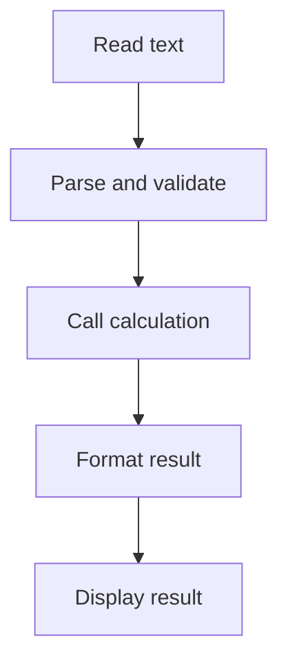

# 15. Input, output, and command-line programs

[Back to the learning path](../README.md)

## Explanation

Prerequisites: functions, type conversion, conditions, and exceptions.

A useful program separates receiving input, validating it, calculating a result, and presenting output. Keep calculations independent of the terminal so they can be reused and tested. `input(prompt)` waits for one line and returns a string without its final newline. Entering 21 produces the text `"21"`; it still needs conversion if you want arithmetic.

Interactive prompts suit manual use. Command-line arguments suit automation because a caller can supply everything at once. A command-line program also has an exit status: zero conventionally means success, while nonzero indicates failure. `argparse` provides parsing, help text, defaults, and conversion errors.

These examples use fixed input or explicit argument lists so they never wait for typing. To practise interactively, replace a fixed input string with `input("Age: ")`. Reading input and interpreting it are separate operations, and either can fail.

## Small examples

### Convert input before calculation

Conversion establishes the kind of value the calculation expects.

```python
raw_age = "21"
age = int(raw_age)
print(age + 1)
```

Output:

```text
22
```

### Control separators and line endings

sep separates print arguments; end is appended after the last argument.

```python
print("red", "green", sep=", ")
print("Loading", end="... ")
print("done")
```

Output:

```text
red, green
Loading... done
```

### Parse a named option

In a real command-line entry point, parse_args() without a list reads the process arguments.

```python
import argparse
parser = argparse.ArgumentParser()
parser.add_argument("--count", type=int, default=1)
args = parser.parse_args(["--count", "3"])
print(args.count)
```

Output:

```text
3
```

### Separate behavior from input

The function can now be called by a terminal interface, a test, or another application.

```python
def greeting(name):
    return f"Hello, {name.strip()}"

print(greeting(" Maya "))
```

Output:

```text
Hello, Maya
```

## Flow diagram



## Common mistakes

Do not use eval to parse input. Choose int, float, JSON, or a parser for the accepted format. Handle invalid input separately from defects in the calculation. Avoid calling input during module import.

## Practice

Add a --name option with default friend. Explain why successful input() does not guarantee successful int().

<details>
<summary>Show a worked answer</summary>

Input can contain words or an empty string. A successful read says nothing about whether it represents an integer.

### One solution

This example runs independently.

```python
import argparse
parser = argparse.ArgumentParser()
parser.add_argument("--name", default="friend")
print(parser.parse_args([]).name)
```

Output:

```text
friend
```

</details>

## Further reading

[Official reference](https://docs.python.org/3/library/argparse.html)
