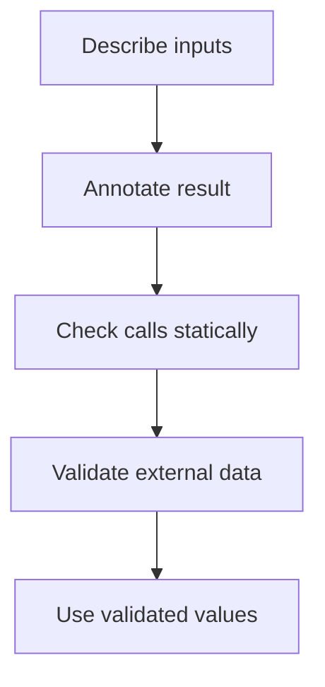

# 16. Type hints and contracts

[Back to the learning path](../README.md)

## Explanation

Prerequisites: functions, collections, classes, and None.

Type hints describe intended inputs and results. A parameter annotation follows a colon, and a return annotation follows an arrow. Python normally does not enforce these annotations at runtime. Editors and static type checkers can use them to find inconsistent calls before execution. Runtime validation is still necessary for external data.

Use `list[int]` for integer elements and `dict[str, int]` for string keys mapped to integers. A union such as `str | None` permits either kind of value. Accepting None does not make an argument optional at the call site: only a default permits omission. A None check narrows what remains possible in the other branch.

Prefer precise contracts over Any when the structure is known. Any permits operations without ordinary static checking. A type variable connects types across inputs and outputs; a TypedDict describes fields in an ordinary dictionary. These are descriptions, not automatic conversions.

## Small examples

### Annotate a function

The function's implementation still performs normal Python operations.

```python
def total(values: list[int]) -> int:
    return sum(values)

print(total([2, 3, 4]))
```

Output:

```text
9
```

### Handle an optional value

The explicit check preserves the distinction between missing text and an empty string.

```python
def display(name: str | None) -> str:
    if name is None:
        return "Anonymous"
    return name.upper()

print(display(None))
print(display("Maya"))
```

Output:

```text
Anonymous
MAYA
```

### Describe dictionary fields

The runtime value is still a dict. Invalid external dictionaries need separate validation.

```python
from typing import TypedDict
class User(TypedDict):
    name: str
    active: bool

user: User = {"name": "Maya", "active": True}
print(user["name"])
```

Output:

```text
Maya
```

### Preserve an element type

For a static checker, the return type follows the element type. The function still needs a policy for an empty list.

```python
from typing import TypeVar
T = TypeVar("T")
def first(values: list[T]) -> T:
    return values[0]

print(first([10, 20]))
print(first(["a", "b"]))
```

Output:

```text
10
a
```

## Flow diagram



## Common mistakes

typing.cast informs a type checker without converting or checking a value. A hint does not document every behavior: exceptions, mutation, and empty-input policies also matter. Python 3.10 supports the syntax used here; newer type-alias syntax is not required.

## Practice

Annotate a function that accepts an integer and returns a label. Explain whether name: str | None gives a default.

<details>
<summary>Show a worked answer</summary>

A union permits several types; it does not supply a default argument.

### One solution

This example runs independently.

```python
def label(number: int) -> str:
    return f"Item {number}"

print(label(7))
```

Output:

```text
Item 7
```

</details>

## Further reading

[Official reference](https://docs.python.org/3/library/typing.html)
