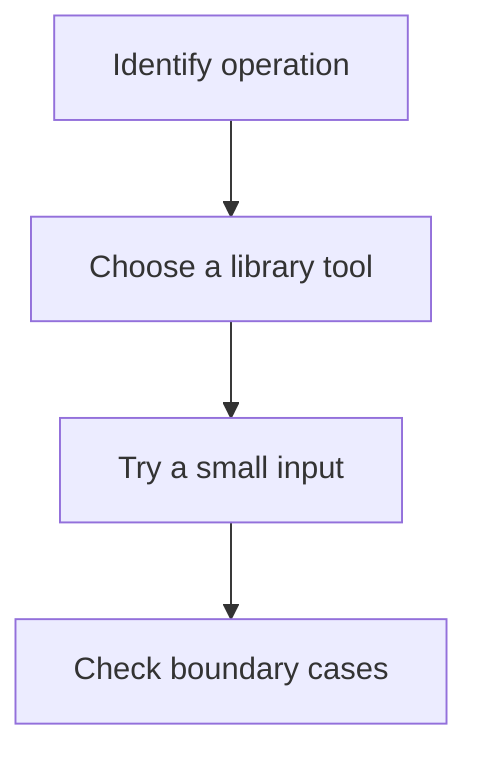

# 17. Useful standard-library tools

[Back to the learning path](../README.md)

## Explanation

Prerequisites: collections, imports, loops, and functions.

The standard library provides reusable tools for common work. Counter counts hashable values; defaultdict creates missing values with a factory; deque supports efficient operations at either end. Choose according to the operation you need, not merely to shorten code.

A date represents a calendar day. A datetime represents a date and time; distinguish naive values from timezone-aware ones when exchanging timestamps. timedelta represents a duration. Calendar arithmetic handles month boundaries, while elapsed-time measurement needs a monotonic clock rather than assumptions about wall-clock changes.

Decimal supports decimal arithmetic and explicit rounding. Construct it from decimal strings to preserve decimal input rather than importing an earlier floating-point approximation. itertools provides iterator-based combinations and transformations. Lazy processing can avoid intermediate collections, but references retained by an iterator still occupy memory.

## Small examples

### Count repeated values

A missing Counter key has a count of zero.

```python
from collections import Counter
counts = Counter(["red", "blue", "red"])
print(counts["red"], counts["green"])
```

Output:

```text
2 0
```

### Group words

The list factory creates an independent list for each missing key.

```python
from collections import defaultdict
groups = defaultdict(list)
for word in ["ant", "ape", "bat"]:
    groups[word[0]].append(word)
print(dict(groups))
```

Output:

```text
{'a': ['ant', 'ape'], 'b': ['bat']}
```

### Use a queue

Removing from the left is a natural deque operation.

```python
from collections import deque
queue = deque(["first", "second"])
queue.append("third")
print(queue.popleft())
print(list(queue))
```

Output:

```text
first
['second', 'third']
```

### Calculate a date

The calculation crosses a month boundary without manually counting its days.

```python
from datetime import date, timedelta
print(date(2024, 1, 30) + timedelta(days=3))
```

Output:

```text
2024-02-02
```

### Use decimal arithmetic

The default context uses round-half-even. Choose a rounding policy deliberately.

```python
from decimal import Decimal
print(Decimal("0.10") * 3)
print(Decimal("2.345").quantize(Decimal("0.01")))
```

Output:

```text
0.30
2.34
```

### Combine iterables

chain itself is lazy; list materializes its results for display.

```python
from itertools import chain
print(list(chain([1, 2], [3, 4])))
```

Output:

```text
[1, 2, 3, 4]
```

## Flow diagram



## Common mistakes

defaultdict bracket lookup can insert a missing key; get does not invoke its factory. A numeric timezone offset does not encode a region's historical rules. Decimal arithmetic still needs decisions about precision and rounding.

## Practice

Count a in banana and find the date seven days after 2024-02-25.

<details>
<summary>Show a worked answer</summary>

Counter accepts characters, and date arithmetic accounts for the leap day.

### One solution

This example runs independently.

```python
from collections import Counter
from datetime import date, timedelta
print(Counter("banana")["a"])
print(date(2024, 2, 25) + timedelta(days=7))
```

Output:

```text
3
2024-03-03
```

</details>

## Further reading

[Official reference](https://docs.python.org/3/library/)
