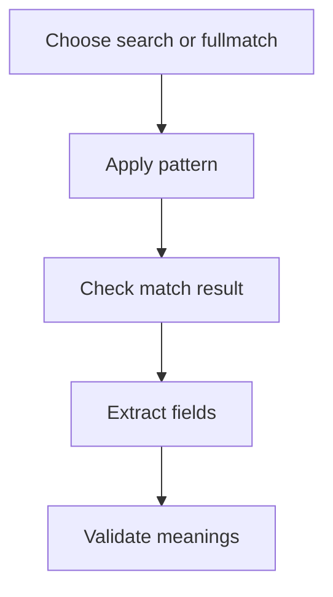

# 18. Regular expressions

[Back to the learning path](../README.md)

## Explanation

Prerequisites: strings, imports, and None checks.

A regular expression describes a text pattern. search finds a match anywhere; fullmatch requires the whole string to match; findall collects matches. A successful search returns a match object. Failure returns None, so check before accessing groups.

Raw strings such as `r"\d+"` let backslashes reach the pattern engine without first being consumed as ordinary string escapes. `+` means one or more, `*` means zero or more, and `[A-Z]` is a character class. Parentheses capture parts of a match. A dot normally matches almost any single character; escape it to mean a literal dot.

Use string methods for simple splitting, prefixes, suffixes, and replacement. Use a parser for formats such as JSON and CSV. A regex recognizes a shape, not necessarily a meaningful value: a date-shaped string may describe an impossible calendar day.

## Small examples

### Find a number

search permits unrelated text before and after the match.

```python
import re
match = re.search(r"\d+", "Order 204 ready")
print(match.group() if match else "No number")
```

Output:

```text
204
```

### Validate an entire identifier

fullmatch prevents a matching prefix from being mistaken for a valid whole input.

```python
import re
pattern = r"[A-Z]{2}-[0-9]{3}"
print(bool(re.fullmatch(pattern, "AB-123")))
print(bool(re.fullmatch(pattern, "AB-123-extra")))
```

Output:

```text
True
False
```

### Capture named fields

Extracted text still needs conversion to the intended type.

```python
import re
match = re.fullmatch(r"(?P<name>[A-Za-z]+):(?P<score>[0-9]+)", "Maya:8")
if match:
    print(match.group("name"), int(match.group("score")))
```

Output:

```text
Maya 8
```

### Replace whitespace runs

sub returns a new string.

```python
import re
print(re.sub(r"\s+", " ", "red   blue\tgreen"))
```

Output:

```text
red blue green
```

## Flow diagram



## Common mistakes

A greedy expression consumes as much as it can while satisfying the pattern. Making it non-greedy does not turn it into a structural parser. Keep patterns understandable and avoid nested ambiguous repetitions on large inputs.

## Practice

Match exactly four ASCII digits. Explain why a date regex alone cannot validate February 31.

<details>
<summary>Show a worked answer</summary>

Calendar rules require date parsing or validation after the textual shape is recognized.

### One solution

This example runs independently.

```python
import re
print(bool(re.fullmatch(r"[0-9]{4}", "2024")))
print(bool(re.fullmatch(r"[0-9]{4}", "20a4")))
```

Output:

```text
True
False
```

</details>

## Further reading

[Official reference](https://docs.python.org/3/library/re.html)
