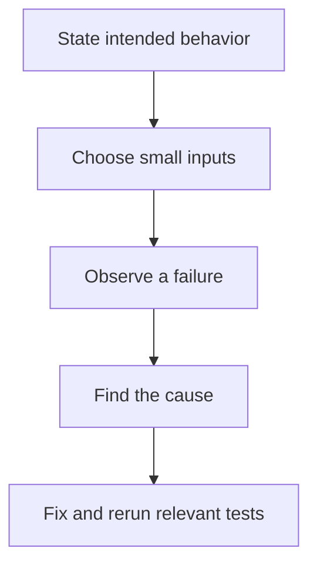

# 19. Testing and debugging

[Back to the learning path](../README.md)

## Explanation

Prerequisites: functions, exceptions, classes, and modules.

A useful test specifies externally meaningful behavior: given an input, what result or exception should occur? Arrange the input, act by calling the code, and assert the outcome. Tests should detect plausible mistakes without depending on every implementation detail.

Cover an ordinary case, a boundary case, and an invalid case. Keep unit tests deterministic by replacing real clocks, networks, and other changing dependencies. A simple injected function often makes a better test collaborator than a complicated mock. Integration tests separately check that real components work together.

To debug, read the exception type and message, then inspect the relevant frames in the traceback. Reduce the failure to a small reproducible input. In an interactive run, breakpoint() enters a debugger; inspect locals, step, and continue. Once you understand the defect, a regression test records the behavior that must stay correct.

## Small examples

### Check normal and empty inputs

These short assertions illustrate expected behavior. Application input validation should not depend on assert.

```python
def total(values):
    return sum(values)

assert total([2, 3]) == 5
assert total([]) == 0
print("Two checks passed")
```

Output:

```text
Two checks passed
```

### Run a unittest suite

The suite runs in memory so the lesson needs no generated test file.

```python
import unittest
class TotalTests(unittest.TestCase):
    def test_empty(self):
        self.assertEqual(sum([]), 0)

suite = unittest.defaultTestLoader.loadTestsFromTestCase(TotalTests)
result = unittest.TestResult()
suite.run(result)
print(result.testsRun, result.wasSuccessful())
```

Output:

```text
1 True
```

### Expect a specific exception

A different exception, or no exception, would fail this check.

```python
import unittest
case = unittest.TestCase()
with case.assertRaises(ValueError):
    int("not a number")
print("Expected error observed")
```

Output:

```text
Expected error observed
```

### Replace an external dependency

The test isolates greeting behavior from how names are loaded.

```python
def welcome(load_name):
    return f"Hello, {load_name()}"

assert welcome(lambda: "Maya") == "Hello, Maya"
print("Greeting checked")
```

Output:

```text
Greeting checked
```

### Verify an interaction

This demonstrates the mock API; real tests should exercise the application code that calls the collaborator.

```python
from unittest.mock import Mock
send = Mock(return_value="sent")
print(send("Hello"))
send.assert_called_once_with("Hello")
```

Output:

```text
sent
```

## Flow diagram



## Common mistakes

Optimization can remove assert statements; use explicit validation in application code. Do not test only that a configured mock returns its configured value. Avoid comparing unstable timing or machine-specific paths. In an actual project, unittest discovery finds test_*.py files; this course keeps examples in Markdown.

## Practice

Test a square function with positive, zero, and negative inputs. Explain why a live network call makes a unit test less reproducible.

<details>
<summary>Show a worked answer</summary>

Network availability, latency, and changing responses are independent of the function being tested.

### One solution

This example runs independently.

```python
def square(number):
    return number * number

for value, expected in [(3, 9), (0, 0), (-2, 4)]:
    assert square(value) == expected
print("Three cases passed")
```

Output:

```text
Three cases passed
```

</details>

## Further reading

[Official reference](https://docs.python.org/3/library/unittest.html)
