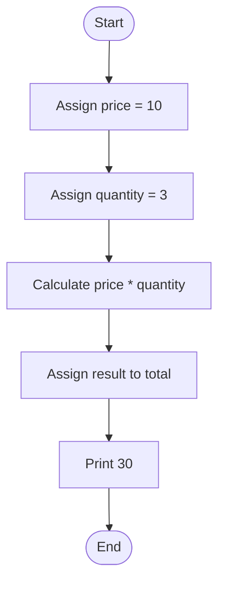

# 2. Variables

[Back to all Python lessons](../README.md)

A variable is a name that refers to a value. Use `=` to assign a value. Python
does not require `let`, `const`, or a type declaration.

## Store and use values

```python
price = 10
quantity = 3
total = price * quantity
print(total)
```

Output:

```text
30
```

Python evaluates the right side of `=` first, then assigns the result to the
name on the left.

## Change a value

```python
score = 5
score = score + 2
print(score)
```

Output:

```text
7
```

`score += 2` is a shorter way to write `score = score + 2`.

## Choose clear names

- Use names such as `user_name` and `total_price`.
- Names can contain letters, digits, and underscores, but cannot start with a digit.
- Names are case-sensitive: `score` and `Score` are different names.
- Do not use Python keywords such as `if` or `for` as variable names.

## Flow diagram



## Common mistake

Using `Score` after assigning `score` does not access the same variable. Keep
the spelling and capitalization consistent.

## Extended lesson

**Learning goals:** Assign and unpack values, distinguish rebinding from mutation, and use meaningful names.

Assignment binds a name to an object. Reassignment changes what that name refers to; it does not change all other names that previously referred to the same object. The object has a type, while the name can later refer to an object of another type. Prefer a consistent meaning and type for each name in ordinary code.

Python evaluates the complete right side before assigning on the left. That makes unpacking and swapping possible without a temporary variable. The number of target names normally must match the number of values. A starred target collects remaining values into a list.

### Swap two values

The original right-hand values are collected before either name is rebound.

```python
left, right = 10, 20
left, right = right, left
print(left, right)
```

Output:

```text
20 10
```

### Unpack a sequence

Use a starred target when you want the first item separately from the rest.

```python
first, *remaining = [3, 5, 8]
print(first)
print(remaining)
```

Output:

```text
3
[5, 8]
```

### Rebinding is not mutation

The new integer is assigned to count; saved still refers to the old integer.

```python
count = 1
saved = count
count += 1
print(count, saved)
```

Output:

```text
2 1
```

## Practice and worked answer

1. Unpack `("Maya", 21)` into `name` and `age`.
2. Predict whether changing `age` later changes `name`.

Try these before reading the answer.

<details>
<summary>Show the explanation and one solution</summary>

The names are separate bindings; assigning a new value to age does not affect name.

### One solution

This example runs independently.

```python
name, age = ("Maya", 21)
age += 1
print(name, age)
```

Output:

```text
Maya 22
```

</details>
