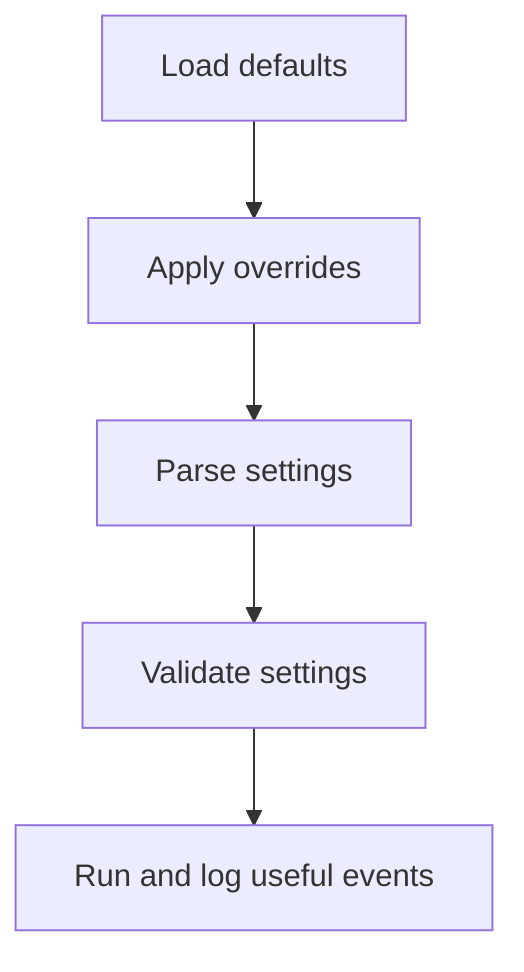

# 20. Logging and configuration

[Back to the learning path](../README.md)

## Explanation

Prerequisites: functions, dictionaries, exceptions, and modules.

Logging records useful events for someone diagnosing an application. DEBUG is for diagnostic details, INFO for normal progress, WARNING for unusual recoverable conditions, ERROR for failed operations, and CRITICAL for severe failures. Configure handlers and formatting at the application entry point; libraries normally use a named logger and leave configuration to their caller.

Configuration can come from defaults, files, environment variables, or command-line arguments. Define the precedence explicitly. Environment variables are strings, so numbers and booleans need parsing and validation. Read settings at the boundary and pass parsed values to functions rather than repeatedly consulting global state.

Keep log messages informative without recording secrets or complete private payloads. Use logging arguments to supply variable data. Handle an exception where you can recover, and choose one place to report an unrecovered failure rather than logging the same traceback in every layer.

## Small examples

### Record an event

An in-memory stream makes the demonstration deterministic.

```python
import io, logging
stream = io.StringIO()
logger = logging.getLogger("course.example")
logger.handlers = [logging.StreamHandler(stream)]
logger.setLevel(logging.INFO)
logger.propagate = False
logger.info("Loaded %s records", 3)
print(stream.getvalue().strip())
```

Output:

```text
Loaded 3 records
```

### Apply overrides

Values on the right replace matching keys on the left.

```python
defaults = {"host": "localhost", "port": "8000"}
overrides = {"port": "9000"}
settings = defaults | overrides
print(settings["host"], int(settings["port"]))
```

Output:

```text
localhost 9000
```

### Parse a Boolean setting

This parser rejects unknown spellings instead of guessing.

```python
def parse_flag(text):
    values = {"true": True, "false": False}
    key = text.strip().lower()
    if key not in values:
        raise ValueError("Use true or false")
    return values[key]

print(parse_flag(" FALSE "))
```

Output:

```text
False
```

### Validate a port

Passing a mapping lets tests avoid changing the real process environment.

```python
def read_port(environment):
    port = int(environment.get("APP_PORT", "8000"))
    if not 1 <= port <= 65535:
        raise ValueError("Invalid port")
    return port

print(read_port({"APP_PORT": "9000"}))
```

Output:

```text
9000
```

## Flow diagram



## Common mistakes

bool('false') is True because the string is not empty. Avoid basicConfig calls in every imported module. logger.exception includes traceback information and belongs inside an exception handler when that information is useful.

## Practice

Merge timeout defaults with an override. Choose a log level for normal startup and a failed file load.

<details>
<summary>Show a worked answer</summary>

INFO usually suits startup. ERROR usually suits a failed operation, depending on the application's recovery policy.

### One solution

This example runs independently.

```python
defaults = {"timeout": 10}
overrides = {"timeout": 20}
print((defaults | overrides)["timeout"])
```

Output:

```text
20
```

</details>

## Further reading

[Official reference](https://docs.python.org/3/library/logging.html)
