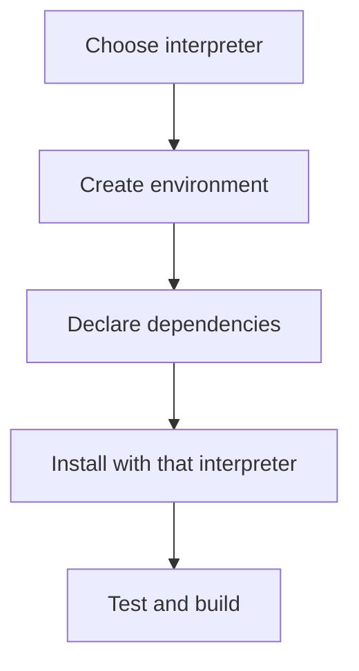

# 21. Environments, dependencies, and packaging

[Back to the learning path](../README.md)

## Explanation

Prerequisites: modules, command-line basics, and files.

An interpreter executes Python. A virtual environment gives one project its own interpreter entry points and installed packages. Activation changes your shell's command lookup; it is optional if you call the environment's interpreter directly. Use `python -m pip` to make the target interpreter explicit.

An import package is a name used in source code. A distribution is what the installer installs; these names can differ. pyproject.toml holds build configuration, metadata, dependencies, and tool settings. Separate reusable source, tests, and packaging metadata so each has a clear responsibility.

Reproducibility requires declared dependencies, an intended Python version, and checks in that environment. pip freeze captures installed versions but is not a portable lock solution for every platform. Applications may pin a resolved environment; reusable libraries usually declare compatible dependency ranges. Build artifacts and publishing are separate steps.

## Small examples

### Check interpreter information

sys.executable identifies the interpreter path. Its exact value varies by machine.

```python
import sys
print(sys.version_info.major)
print(isinstance(sys.executable, str))
```

Output:

```text
3
True
```

### Understand an import identity

A dotted import identifies a module inside a package.

```python
import email.message
print(email.message.__name__)
```

Output:

```text
email.message
```

### Separate metadata access

A real lookup could use importlib.metadata.version; injection makes this example independent of installed third-party packages.

```python
def describe(name, lookup_version):
    return f"{name} {lookup_version(name)}"

print(describe("demo", lambda name: "1.0"))
```

Output:

```text
demo 1.0
```

## Flow diagram



## Common mistakes

A globally installed distribution may be absent from a project's environment. Do not copy a virtual environment between machines as your deployment strategy; recreate it from declared inputs. A local module can shadow an installed package.

## Practice

Explain the difference between creating and activating an environment. Check whether the interpreter supports Python 3.10 syntax.

<details>
<summary>Show a worked answer</summary>

Creation makes the environment. Activation changes how the shell resolves commands.

### One solution

This example runs independently.

```python
import sys
print(sys.version_info >= (3, 10))
```

Output:

```text
True
```

</details>

## Further reading

[Official reference](https://packaging.python.org/en/latest/tutorials/packaging-projects/)

## Environment commands

These are commands to practise in your own project, not required package installation
for reading the lessons.

```bash
python3 -m venv .venv
source .venv/bin/activate
python -m pip --version
```

On Windows PowerShell, create with `py -m venv .venv` and activate with
`.venv\Scripts\Activate.ps1`. Run `deactivate` to leave the environment.

## A small package layout

```text
project/
  pyproject.toml
  README.md
  src/
    greeting/
      __init__.py
      service.py
  tests/
    test_service.py
```

This is a layout illustration; the course update generates no such source files.
A minimal packaging configuration for that example could be:

```toml
[build-system]
requires = ["setuptools"]
build-backend = "setuptools.build_meta"

[project]
name = "greeting-example"
version = "0.1.0"
requires-python = ">=3.10"

[tool.setuptools.packages.find]
where = ["src"]
```

After creating the actual package, `python -m pip install -e .` installs it for
editable development. Install a build frontend with `python -m pip install build`,
then use `python -m build` to produce distribution artifacts. Building does not
publish them. Test imports from an installed environment so accidental current-directory
imports do not hide packaging mistakes.
