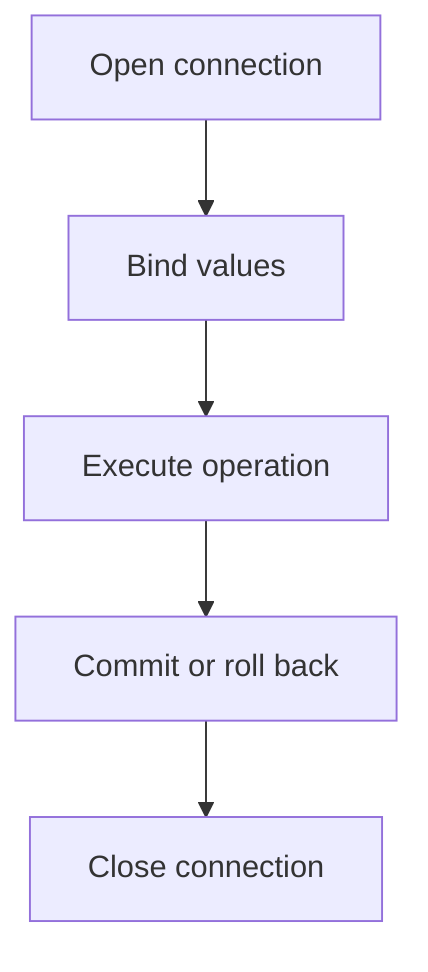

# 22. Databases and SQLite

[Back to the learning path](../README.md)

## Explanation

Prerequisites: functions, tuples, context managers, and exceptions.

A relational database stores rows in tables with named columns. A primary key identifies a row. SQL statements create structures and query or modify values. Python's sqlite3 module provides a local database without a separate server. The examples use an in-memory database and close it after each demonstration.

A transaction groups changes into a unit that can be committed or rolled back. Choose its boundaries around one coherent operation. A connection context manager commits or rolls back a transaction as appropriate; it does not close the connection. contextlib.closing handles that distinct resource-lifetime task.

Bind values through placeholders rather than interpolating them into SQL. Binding keeps query structure separate from data. Placeholders do not substitute table or column names. Constraints such as UNIQUE and NOT NULL preserve rules across writers. Persistent applications also need schema migrations, indexes appropriate to queries, and a concurrency policy.

## Small examples

### Insert and query safely

The SQL and its bound values are separate arguments.

```python
import sqlite3
from contextlib import closing
with closing(sqlite3.connect(":memory:")) as db:
    db.execute("CREATE TABLE users (id INTEGER PRIMARY KEY, name TEXT)")
    db.execute("INSERT INTO users (name) VALUES (?)", ("Maya",))
    row = db.execute("SELECT name FROM users WHERE id = ?", (1,)).fetchone()
    print(row[0])
```

Output:

```text
Maya
```

### Insert multiple rows

ORDER BY requests a defined result order.

```python
import sqlite3
from contextlib import closing
with closing(sqlite3.connect(":memory:")) as db:
    db.execute("CREATE TABLE scores (value INTEGER)")
    db.executemany("INSERT INTO scores VALUES (?)", [(8,), (3,)])
    print(db.execute("SELECT value FROM scores ORDER BY value").fetchall())
```

Output:

```text
[(3,), (8,)]
```

### Roll back a failed operation

The exception leaves the transaction block, which rolls back the insert before the handler runs.

```python
import sqlite3
from contextlib import closing
with closing(sqlite3.connect(":memory:")) as db:
    db.execute("CREATE TABLE items (name TEXT)")
    try:
        with db:
            db.execute("INSERT INTO items VALUES (?)", ("apple",))
            raise ValueError("Cancel")
    except ValueError:
        pass
    print(db.execute("SELECT COUNT(*) FROM items").fetchone()[0])
```

Output:

```text
0
```

### Recognize a missing row

No matching row is represented by None, not a tuple of empty strings.

```python
import sqlite3
from contextlib import closing
with closing(sqlite3.connect(":memory:")) as db:
    db.execute("CREATE TABLE users (name TEXT)")
    print(db.execute("SELECT name FROM users").fetchone() is None)
```

Output:

```text
True
```

## Flow diagram



## Common mistakes

A one-element tuple needs a comma. A connection's with block does not close it. An ORM does not remove transaction or query-cost decisions. The examples use sqlite3's default transaction behavior; applications should choose and document their transaction mode.

## Practice

Write a query for scores greater than a bound threshold. Explain why ('Maya',) differs from ('Maya').

<details>
<summary>Show a worked answer</summary>

The first expression is a tuple; parentheses without a comma only group the string.

### One solution

This example runs independently.

```python
query = "SELECT value FROM scores WHERE value > ?"
parameters = (5,)
print(query)
print(parameters)
```

Output:

```text
SELECT value FROM scores WHERE value > ?
(5,)
```

</details>

## Further reading

[Official reference](https://docs.python.org/3/library/sqlite3.html)
