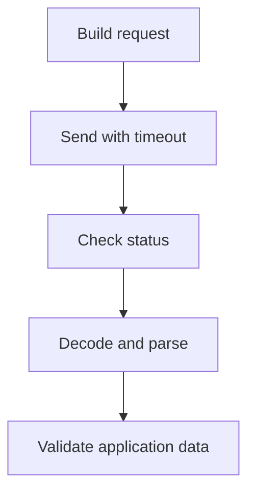

# 23. HTTP and networking fundamentals

[Back to the learning path](../README.md)

## Explanation

Prerequisites: strings, bytes, dictionaries, JSON, exceptions, and functions.

An HTTP request contains a method, a target, headers, and possibly a body. A response contains a status, headers, and a body. A successful connection does not necessarily mean the requested operation succeeded. GET generally retrieves a representation; other methods express other operations and have different retry implications.

A URL has components such as scheme, host, path, and query. Encode query data with a URL tool rather than concatenating raw text. Response data arrives as bytes. Decode according to the representation and parse only when you know the format. Even valid JSON may have the wrong shape for your application.

Real clients need timeouts, appropriate size limits, and a deliberate retry policy. Retrying an operation can repeat side effects. The examples below do not perform network requests: they isolate URL preparation and response handling so behavior is reproducible.

## Small examples

### Encode query values

Encoding keeps user text from changing the query structure.

```python
from urllib.parse import urlencode
print(urlencode({"q": "python basics", "page": 2}))
```

Output:

```text
q=python+basics&page=2
```

### Inspect a URL

Parsing a URL and deciding whether the URL is allowed are different operations.

```python
from urllib.parse import urlsplit
parts = urlsplit("https://example.com/search?q=python")
print(parts.scheme, parts.hostname)
print(parts.path, parts.query)
```

Output:

```text
https example.com
/search q=python
```

### Parse and validate response data

Validation checks the outer structure before reading a field.

```python
import json
body = b'{"name": "Maya", "active": true}'
data = json.loads(body)
if not isinstance(data, dict) or not isinstance(data.get("name"), str):
    raise ValueError("Expected a name")
print(data["name"])
```

Output:

```text
Maya
```

### Separate transport from parsing

The collaborator supplies fixed bytes for a unit test. A real boundary would also check status and schema.

```python
import json
def read_name(fetch):
    return json.loads(fetch())["name"]

print(read_name(lambda: b'{"name": "Maya"}'))
```

Output:

```text
Maya
```

## Flow diagram



## Common mistakes

Transport errors, unsuccessful HTTP status, decoding errors, and application validation are different failure stages. Do not retry indefinitely or assume a status of 200 guarantees a specific JSON field.

## Practice

Encode a color value containing an ampersand. Explain the difference between a query parameter and a JSON body field.

<details>
<summary>Show a worked answer</summary>

Query parameters belong to the URL; body fields belong to the request representation.

### One solution

This example runs independently.

```python
from urllib.parse import urlencode
print(urlencode({"color": "red & blue"}))
```

Output:

```text
color=red+%26+blue
```

</details>

## Further reading

[Official reference](https://docs.python.org/3/library/urllib.request.html)
