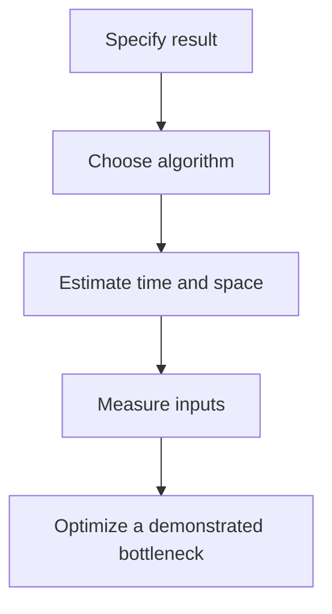

# 24. Algorithms and complexity

[Back to the learning path](../README.md)

## Explanation

Prerequisites: loops, functions, collections, recursion, and generators.

An algorithm is a procedure for solving a problem. Complexity describes how resource use grows with input size, not an exact duration. O(1) means cost does not grow with input size under the model. O(n) grows linearly. O(n log n) often describes comparison sorting, while comparing every item with every other item can require O(n squared) work.

List membership is linear in the worst case. Set and dictionary lookups are average constant-time operations under ordinary assumptions, but constructing them costs time and memory. Include setup work when comparing approaches. For one tiny query, building a set may not help; for repeated queries, it may.

Start with correctness and clarity. Then consider the input sizes, extra memory, ordering requirements, and cost of comparisons. Measure representative workloads before optimizing. Lazy iteration can reduce intermediate storage without reducing the total number of calculations.

## Small examples

### One pass through values

The number of additions grows in proportion to the number of items.

```python
total = 0
for number in [2, 4, 6]:
    total += number
print(total)
```

Output:

```text
12
```

### Remove duplicates while preserving order

A set serves membership checks while the list stores first-seen order.

```python
seen = set()
unique = []
for value in [3, 1, 3, 2]:
    if value not in seen:
        seen.add(value)
        unique.append(value)
print(unique)
```

Output:

```text
[3, 1, 2]
```

### Search sorted data

bisect finds an insertion position. Confirm equality if you need to establish membership.

```python
from bisect import bisect_left
values = [2, 4, 8, 10]
index = bisect_left(values, 8)
print(index)
print(index < len(values) and values[index] == 8)
```

Output:

```text
2
True
```

### Avoid intermediate storage

The generator supplies each result directly to sum.

```python
print(sum(number * number for number in range(4)))
```

Output:

```text
14
```

## Flow diagram



## Common mistakes

Binary search requires sorted input. Inserting into a list can still be linear even if finding the insertion point is logarithmic. Nested loops are not automatically quadratic: count actual total iterations. Average hash-table behavior is not a worst-case promise.

## Practice

Find the largest value in a nonempty list without sorting it. State how its work grows.

<details>
<summary>Show a worked answer</summary>

A single pass uses O(n) comparisons and constant extra state.

### One solution

This example runs independently.

```python
values = [4, 9, 2]
largest = values[0]
for value in values:
    if value > largest:
        largest = value
print(largest)
```

Output:

```text
9
```

</details>

## Further reading

[Official reference](https://docs.python.org/3/library/bisect.html)
