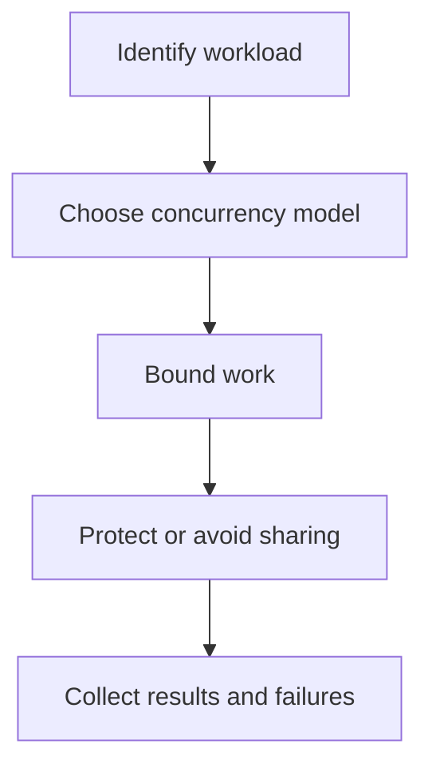

# 25. Concurrency and parallelism

[Back to the learning path](../README.md)

## Explanation

Prerequisites: functions, context managers, exceptions, and the advanced async lessons.

Concurrency lets activities make progress during overlapping periods. Parallelism means simultaneous execution. Async tasks cooperate in an event loop: another task can run when the current task yields. Threads share a process and its objects. Processes have separate memory and communicate explicitly.

Choose according to the workload. Async libraries suit waiting operations when the call path cooperates. Threads can adapt blocking I/O. Processes can run CPU-heavy Python work across cores but add startup and serialization costs. In CPython builds with the GIL enabled, threads do not generally execute Python bytecode in parallel. Native extensions and free-threaded builds need more specific reasoning.

Shared mutable state requires coordination. Protect critical sections with locks or avoid sharing through queues and independent results. Bound concurrent work so a large input cannot create unlimited operations. The GIL is not a substitute for protecting multi-step application invariants.

## Small examples

### Collect thread results

map yields results in input order. This demonstrates the API, not a speed improvement.

```python
from concurrent.futures import ThreadPoolExecutor
with ThreadPoolExecutor(max_workers=2) as pool:
    print(list(pool.map(str.upper, ["red", "blue"])))
```

Output:

```text
['RED', 'BLUE']
```

### Protect shared state

The lock protects the complete update.

```python
from threading import Lock
from concurrent.futures import ThreadPoolExecutor
lock = Lock()
count = 0
def increment(_):
    global count
    with lock:
        count += 1
with ThreadPoolExecutor(max_workers=2) as pool:
    list(pool.map(increment, range(5)))
print(count)
```

Output:

```text
5
```

### Complete queued work

join waits for task accounting to reach zero, not merely for the queue to be empty.

```python
from queue import Queue
queue = Queue()
queue.put("job")
print(queue.get())
queue.task_done()
queue.join()
print("Finished")
```

Output:

```text
job
Finished
```

### Bound async concurrency

The semaphore bounds work inside its block; it does not bound how many task objects are created.

```python
import asyncio
async def main():
    limit = asyncio.Semaphore(2)
    async def work(number):
        async with limit:
            await asyncio.sleep(0)
            return number * 2
    print(await asyncio.gather(*(work(n) for n in range(3))))
asyncio.run(main())
```

Output:

```text
[0, 2, 4]
```

## Flow diagram



## Common mistakes

Do not call blocking time.sleep in an async coroutine. Thread pools can be slower than ordinary loops for tiny calculations. Spawned process workers need importable functions and serializable inputs; do not depend on platform-specific fork behavior. Large async inputs may need a bounded producer/worker queue, not a task for every item.

## Practice

Choose a starting approach for an async HTTP client, a blocking I/O API, and CPU-heavy pure-Python work. Complete a queue item even if handling it fails.

<details>
<summary>Show a worked answer</summary>

Consider async tasks, threads, and processes respectively, then measure. finally ensures task accounting is updated.

### One solution

This example runs independently.

```python
from queue import Queue
queue = Queue()
queue.put(4)
item = queue.get()
try:
    print(item * 2)
finally:
    queue.task_done()
queue.join()
```

Output:

```text
8
```

</details>

## Further reading

[Official reference](https://docs.python.org/3/library/concurrent.futures.html)

## Process workers: a script recipe

Process workers must be able to import their function's defining module. This recipe
is intended for a saved script in your own project, run from a terminal. It is separate
from the independent interactive examples.

```python-script
from concurrent.futures import ProcessPoolExecutor

def square(number):
    return number * number

if __name__ == "__main__":
    with ProcessPoolExecutor(max_workers=2) as pool:
        print(list(pool.map(square, [1, 2, 3])))
```

Expected output: `[1, 4, 9]`. Use a substantially larger CPU workload before measuring
whether processes help. Start methods differ across platforms and Python versions;
write importable workers and retain the main guard instead of relying on fork behavior.
