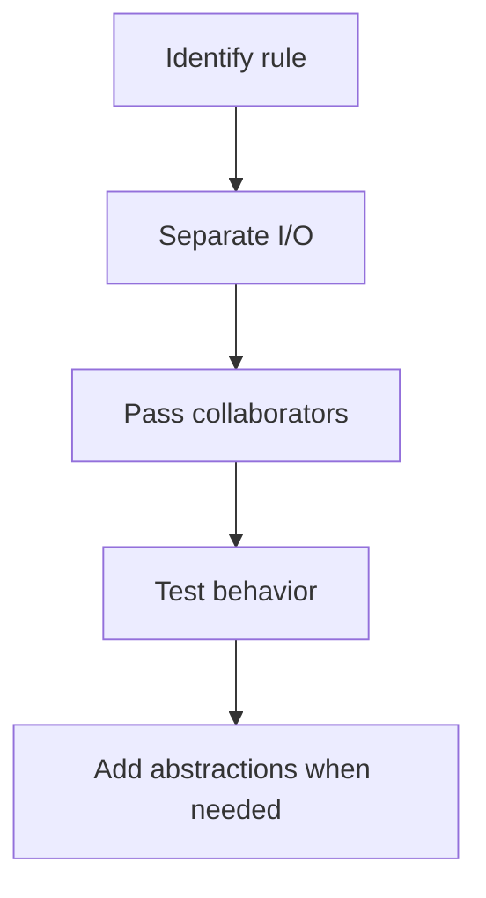

# 26. Program design and architecture

[Back to the learning path](../README.md)

## Explanation

Prerequisites: functions, classes, type hints, testing, modules, and exceptions.

Growing programs become difficult because of interactions between parts. Separate calculations from I/O so rules can be tested without a terminal, database, or network. A function can express a rule; a class is useful when operations share state or expose an interface.

Dependency injection means passing a collaborator instead of constructing or looking it up inside the function. It can be as simple as passing a callable. Composition combines collaborators. Inheritance is appropriate when a subtype can honor the parent's contract, not merely when two classes share a few lines.

Organize modules around responsibilities. Keep stable rules independent of changing infrastructure. Translate exceptions at boundaries when doing so adds useful context, preserving the original cause. Avoid introducing a layer or design pattern before it solves a real testing, reuse, or change-management problem.

## Small examples

### Keep calculation independent

The rule can be tested without a display or database.

```python
def discounted_price(price, discount):
    if not 0 <= discount <= price:
        raise ValueError("Invalid discount")
    return price - discount

print(discounted_price(20, 3))
```

Output:

```text
17
```

### Inject a sender

The caller chooses whether sending means appending to a test list or performing external I/O.

```python
def notify(name, send):
    send(f"Hello, {name}")

messages = []
notify("Maya", messages.append)
print(messages)
```

Output:

```text
['Hello, Maya']
```

### Compose a formatter

The report uses a collaborator rather than inheriting from it.

```python
class Report:
    def __init__(self, format_value):
        self.format_value = format_value
    def render(self, value):
        return self.format_value(value)

print(Report(lambda value: f"Total: {value}").render(12))
```

Output:

```text
Total: 12
```

### Describe a structural contract

A compatible class need not inherit from the Protocol for static structural typing.

```python
from typing import Protocol
class Named(Protocol):
    name: str
class User:
    name = "Maya"
def greet(user: Named) -> str:
    return f"Hello, {user.name}"

print(greet(User()))
```

Output:

```text
Hello, Maya
```

## Flow diagram



## Common mistakes

A Protocol is not automatic runtime validation. A class doing file I/O, parsing, calculations, and messaging has several reasons to change. Avoid hiding required dependencies in globals.

## Practice

Separate reading expense data, summing values, and displaying a report. Write just the calculation.

<details>
<summary>Show a worked answer</summary>

The calculation is independent of how data arrives and where the report goes.

### One solution

This example runs independently.

```python
def expense_total(amounts):
    return sum(amounts)

print(expense_total([10, 5, 2]))
```

Output:

```text
17
```

</details>

## Further reading

[Official reference](https://docs.python.org/3/library/typing.html#typing.Protocol)
