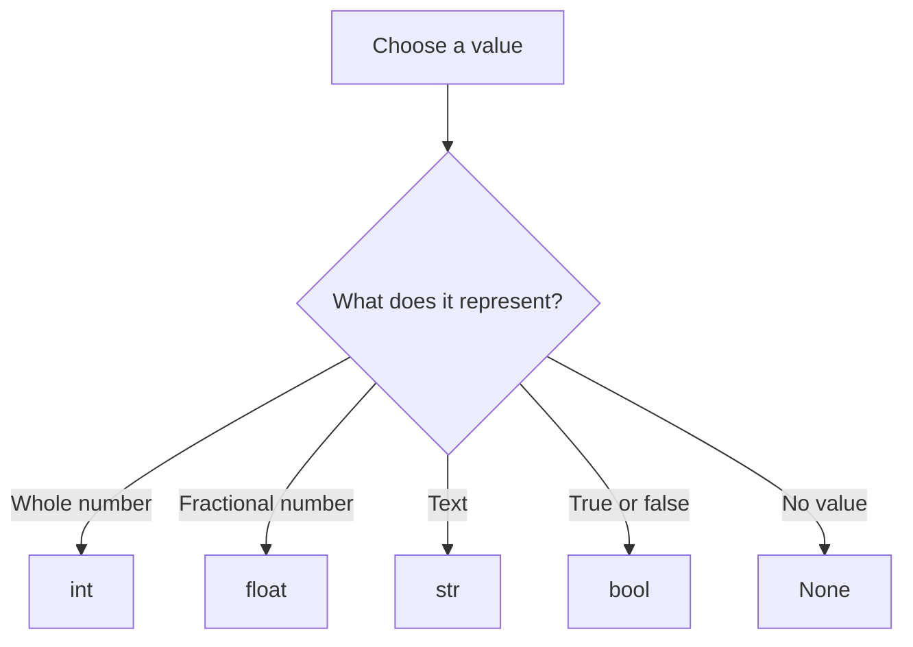

# 3. Data Types

[Back to all Python lessons](../README.md)

A value's type determines what operations it supports. These are common
built-in types:

| Type | Example | Meaning |
| --- | --- | --- |
| `int` | `12` | Whole number |
| `float` | `2.5` | Number with a fractional part |
| `str` | `"Hello"` | Text |
| `bool` | `True` | True or false |
| `NoneType` | `None` | No value |

## Check a type

```python
age = 20
name = "Maya"
print(type(age).__name__)
print(type(name).__name__)
```

Output:

```text
int
str
```

`type(value)` returns the value's type. `.__name__` gives its name as text.

## Numbers and text behave differently

```python
print(2 + 3)
print("2" + "3")
```

Output:

```text
5
23
```

For numbers, `+` adds. For strings, `+` joins text.

## Booleans and missing values

```python
is_ready = True
result = None
print(is_ready)
print(result)
```

Output:

```text
True
None
```

`True`, `False`, and `None` must use these exact capital letters. `None` is
different from zero and from an empty string.

## Flow diagram



## Common mistake

`"Age: " + 20` raises `TypeError` because it mixes text and a number. Use
`print("Age:", 20)` to display them together, or convert the number with `str(20)`.

## Extended lesson

**Learning goals:** Choose built-in types, check a type, and recognize numeric precision and text/byte boundaries.

Use integers for whole-number counts, floating-point numbers for approximate real-number calculations, strings for text, booleans for conditions, and `None` to represent an absent value. A float may also represent a whole-number value, such as `2.0`; the fractional part is not what determines the object's type.

`isinstance(value, SomeType)` accepts instances of that type and its subclasses. One detail is that `bool` is a subclass of `int`. Text (`str`) and encoded data (`bytes`) are different: encode text before writing bytes to a byte-oriented interface, and decode bytes when you know their encoding.

### Check a type without comparing its printed name

isinstance is useful at program boundaries, although it does not replace a well-defined input contract.

```python
print(isinstance(12, int))
print(isinstance("12", int))
print(isinstance(True, int))
```

Output:

```text
True
False
True
```

### Approximate floating-point values

Binary floating point cannot represent every decimal exactly. isclose checks approximate equality.

```python
from math import isclose
print(0.1 + 0.2 == 0.3)
print(isclose(0.1 + 0.2, 0.3))
```

Output:

```text
False
True
```

### Encode and decode text

Encoding changes the representation, not the intended text.

```python
text = "cafe"
data = text.encode("utf-8")
print(data)
print(data.decode("utf-8"))
```

Output:

```text
b'cafe'
cafe
```

## Practice and worked answer

1. Choose types for an item count, a name, a success flag, and a missing result.
2. Check whether `3.0` is a float.

Try these before reading the answer.

<details>
<summary>Show the explanation and one solution</summary>

Use int, str, bool, and None respectively. The literal 3.0 is a float even though its value is a whole number.

### One solution

This example runs independently.

```python
print(type(3.0).__name__)
print(isinstance(3.0, float))
```

Output:

```text
float
True
```

</details>
