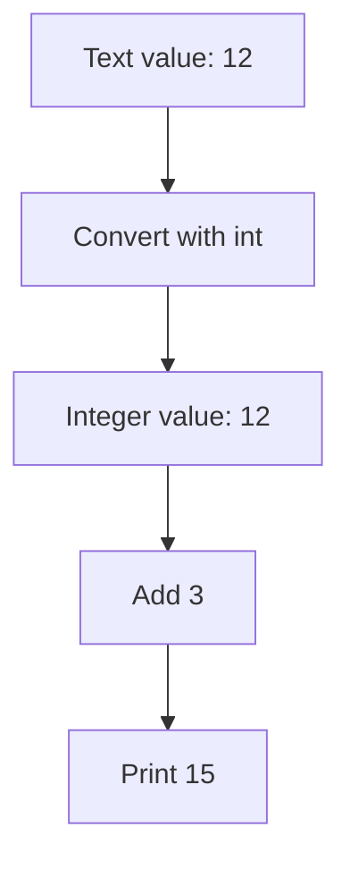

# 4. Type Conversion

[Back to all Python lessons](../README.md)

Type conversion, also called casting, creates a value of a different type.
Common conversion functions are `int()`, `float()`, `str()`, and `bool()`.

## Convert text to a whole number

```python
text = "12"
number = int(text)
print(number + 3)
```

Output:

```text
15
```

`text` is still a string. The converted integer is assigned to `number`.

## Convert decimal text and numbers

```python
price = float("2.5")
print(price + 1)
print(int(3.9))
```

Output:

```text
3.5
3
```

`int()` removes the fractional part of a float toward zero; it does not round.

## Convert a number to text

```python
age = 20
message = "Age: " + str(age)
print(message)
```

Output:

```text
Age: 20
```

## Convert to a Boolean

```python
print(bool(0))
print(bool(""))
print(bool("False"))
```

Output:

```text
False
False
True
```

Zero, empty strings, empty collections, and `None` are false in a Boolean
context. A nonempty string is true, even when its text is `"False"`.

## Flow diagram



## Common mistake

`int("2.5")` raises `ValueError` because the string does not represent a whole
number. Use `float("2.5")` when you need a decimal value.

## Extended lesson

**Learning goals:** Convert external text deliberately and distinguish invalid input from valid zero or empty values.

Conversion creates a new value; it does not change the original object. Choose conversions based on what the input means. For example, an age may need an integer, while a measured length may need a float. Converting through float just to accept an integer can silently discard a fractional part.

`bool(text)` checks whether text is empty, not whether its words mean true or false. For configuration strings such as "yes" or "false", define which spellings you accept. Invalid text should be reported instead of silently interpreted as zero. The exception example below previews the error-handling lesson.

### Conversion can fail

Catch the specific conversion error and provide a clear response.

```python
try:
    age = int("twenty")
except ValueError:
    print("Use digits for age")
```

Output:

```text
Use digits for age
```

### Parse a known Boolean vocabulary

This sample accepts the true spellings shown; a full parser should also reject unknown values.

```python
text = " YES "
enabled = text.strip().lower() in {"true", "yes", "1"}
print(enabled)
```

Output:

```text
True
```

### Convert a collection

list consumes the iterable and creates a list of its values.

```python
digits = "123"
print(list(digits))
print([int(digit) for digit in digits])
```

Output:

```text
['1', '2', '3']
[1, 2, 3]
```

## Practice and worked answer

1. Explain why `bool("0")` is True.
2. Convert the string `"18"` into an integer and add two.

Try these before reading the answer.

<details>
<summary>Show the explanation and one solution</summary>

The string is nonempty, so it is truthy regardless of what its text looks like.

### One solution

This example runs independently.

```python
age = int("18")
print(age + 2)
```

Output:

```text
20
```

</details>
