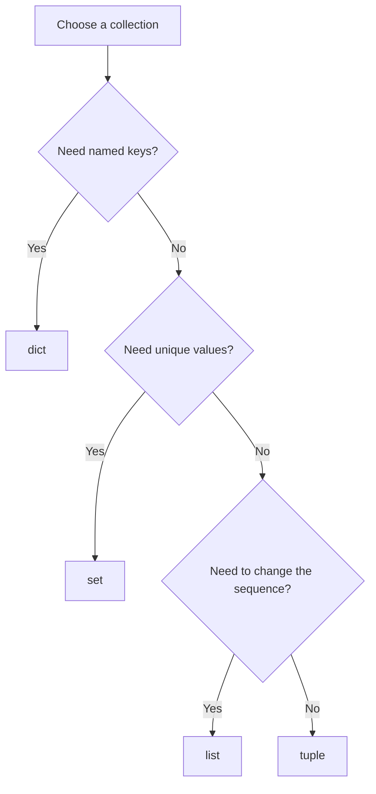

# 5. Data Structures

[Back to all Python lessons](../README.md)

Collections hold several values together. Choose one based on how you need to
store and access those values.

| Type | Purpose | Can change? |
| --- | --- | --- |
| `list` | Ordered sequence that allows duplicates | Yes |
| `tuple` | Ordered sequence that allows duplicates | Its items cannot be reassigned |
| `dict` | Values stored under unique keys | Yes |
| `set` | Unique values with no guaranteed order | Yes |

## List: an editable sequence

```python
fruits = ["apple", "banana"]
fruits.append("mango")
print(fruits[0])
print(fruits)
```

Output:

```text
apple
['apple', 'banana', 'mango']
```

List indexes start at `0`. `append()` adds one value at the end.

## Tuple: a fixed sequence

```python
point = (3, 4)
print(point[0])
print(point[1])
```

Output:

```text
3
4
```

You cannot assign a new value to `point[0]`. A tuple with one item needs a
trailing comma, such as `(3,)`.

## Dictionary: named values

```python
student = {"name": "Maya", "age": 20}
student["age"] = 21
print(student["name"])
print(student["age"])
```

Output:

```text
Maya
21
```

A dictionary looks up a value by its key. Keys must be hashable; strings and
numbers are common choices.

## Set: unique values

```python
numbers = {3, 1, 3, 2}
print(sorted(numbers))
print(2 in numbers)
```

Output:

```text
[1, 2, 3]
True
```

The duplicate `3` is stored once. `sorted()` returns a sorted list, so this
example has predictable output. Use `set()` for an empty set; `{}` is an empty
dictionary.

## Flow diagram



## Common mistake

For `fruits = ["apple", "banana"]`, `fruits[2]` raises `IndexError`. The valid
indexes are `0` and `1` because indexing starts at zero.

## Extended lesson

**Learning goals:** Select collections based on lookup, uniqueness, ordering, and mutation requirements.

Lists work well for ordered values that change. Tuples describe fixed groupings of values. Dictionaries map hashable keys to values and preserve insertion order. Sets store distinct hashable values; their iteration order is not an ordering contract.

Mutating methods such as list.append and list.sort usually return `None`. This helps distinguish changing an existing object from producing a new one. `sorted()` builds a new list. A tuple cannot replace its elements, but an element may itself refer to a mutable list. Dictionary membership checks keys, not values.

### Sort in place or make a sorted copy

Keep the original order when it has meaning by using sorted.

```python
scores = [3, 1, 2]
ordered = sorted(scores)
print(scores, ordered)
print(scores.sort())
print(scores)
```

Output:

```text
[3, 1, 2] [1, 2, 3]
None
[1, 2, 3]
```

### Look up a missing key safely

get returns a default without inserting it. Square-bracket lookup would raise KeyError.

```python
user = {"name": "Maya"}
print(user.get("city", "Unknown"))
print("city" in user)
print(list(user.items()))
```

Output:

```text
Unknown
False
[('name', 'Maya')]
```

### Compare sets

Intersection finds shared values; difference finds values missing from another set.

```python
required = {"read", "write"}
granted = {"read"}
print(sorted(required & granted))
print(sorted(required - granted))
```

Output:

```text
['read']
['write']
```

### A tuple may hold mutable contents

The tuple still refers to the same list after the list changes.

```python
record = ([1], "fixed")
record[0].append(2)
print(record)
```

Output:

```text
([1, 2], 'fixed')
```

## Practice and worked answer

1. Choose a collection for unique tags and another for prices looked up by product name.
2. Remove duplicate numbers from `[3, 1, 3]` and show them in sorted order.

Try these before reading the answer.

<details>
<summary>Show the explanation and one solution</summary>

A set is suitable for tags; a dictionary maps product names to prices. Sorting the set gives deterministic display order.

### One solution

This example runs independently.

```python
print(sorted(set([3, 1, 3])))
```

Output:

```text
[1, 3]
```

</details>
