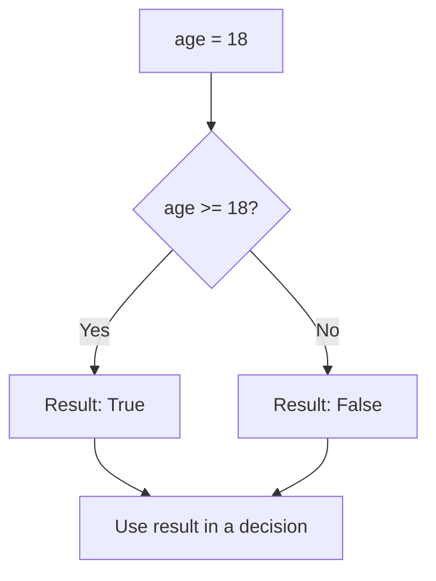

# 6. Equality and Comparisons

[Back to all Python lessons](../README.md)

Comparisons produce `True` or `False`. Use the result to make a decision.

| Operator | Meaning |
| --- | --- |
| `==` | Equal values |
| `!=` | Different values |
| `<` and `>` | Less than and greater than |
| `<=` and `>=` | Less than or equal; greater than or equal |
| `is` | The same object |

## Compare values

```python
age = 18
print(age == 18)
print(age >= 18)
print(age != 18)
```

Output:

```text
True
True
False
```

Python uses `==` for value equality; it has no `===` operator. For ordinary
numbers and strings, `5 == "5"` is false because Python does not convert the
string to a number for the comparison.

## Equality and identity

```python
first = [1, 2]
second = [1, 2]
alias = first
print(first == second)
print(first is second)
print(first is alias)
```

Output:

```text
True
False
True
```

The two lists have equal contents but are separate objects. `alias` refers to
the very same list as `first`.

## Check for a missing value

```python
result = None
print(result is None)
```

Output:

```text
True
```

Use `is None` or `is not None` to check for `None`.

## Flow diagram



## Common mistake

Using `is` to compare numbers or strings can give misleading results. Use
`==` to compare their values; reserve `is` for object identity checks such as
`result is None`.

## Extended lesson

**Learning goals:** Separate value equality, identity, ordering, and approximate numeric comparison.

Equality asks whether values compare equal. Identity asks whether two references designate exactly the same object. Separate lists with equal elements compare equal, but they are not identical. Do not infer identity from implementation optimizations such as integer caching or string interning.

Ordering is a separate operation. Not every pair of types can be ordered: a string and an integer cannot normally be sorted against each other. Python supports chained comparisons, allowing a range check to read naturally. A custom class can define equality; that does not make identity customizable.

### Compare across numeric types

Numeric equality can cross type boundaries; Python equality is not a JavaScript strict-equality operator.

```python
print(1 == 1.0)
print(True == 1)
print("1" == 1)
```

Output:

```text
True
True
False
```

### Check a range

The chained comparison means both boundaries must hold.

```python
age = 21
print(18 <= age < 65)
print(age in [18, 21, 30])
```

Output:

```text
True
True
```

### Preserve valid false values

A missing value and zero can require different behavior.

```python
value = 0
print(value is None)
print(not value)
```

Output:

```text
False
True
```

## Practice and worked answer

1. Create two equal lists and predict both `==` and `is`.
2. Explain why `if not value` cannot distinguish zero from None.

Try these before reading the answer.

<details>
<summary>Show the explanation and one solution</summary>

Both zero and None are false in a condition. Use an explicit None check when zero is valid.

### One solution

This example runs independently.

```python
a = [1]
b = [1]
print(a == b)
print(a is b)
```

Output:

```text
True
False
```

</details>
