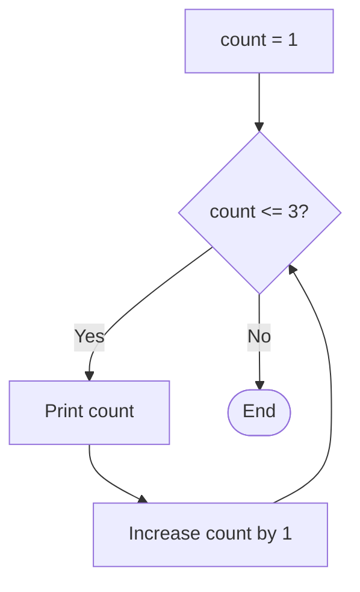

# 7. Loops and Iteration

[Back to all Python lessons](../README.md)

A loop repeats a block of code. Python uses a colon and indentation to mark
the block. Use four spaces for each indentation level.

## `for`: visit each value

```python
for number in range(1, 4):
    print(number)
```

Output:

```text
1
2
3
```

`range(1, 4)` produces `1`, `2`, and `3`: the stop value `4` is excluded.
`range(3)` starts at `0`. A `for` loop can also visit items in a list or
characters in a string.

## `while`: repeat while a condition is true

```python
count = 1
while count <= 3:
    print(count)
    count += 1
```

Output:

```text
1
2
3
```

The condition is checked before each repetition. Increasing `count` eventually
makes the condition false, so the loop ends.

## `break`: end the loop early

```python
for number in range(1, 5):
    if number == 3:
        break
    print(number)
```

Output:

```text
1
2
```

`break` exits the nearest enclosing loop immediately. Here, `3` is never
printed.

## `continue`: skip to the next repetition

```python
for number in range(1, 4):
    if number == 2:
        continue
    print(number)
```

Output:

```text
1
3
```

`continue` skips the remaining statements in the current repetition. The loop
then moves to the next number.

## Flow diagram

This diagram follows the `while` example.



## Common mistake

Forgetting `count += 1` in the `while` example leaves `count` at `1`. The
condition stays true, so the loop keeps printing forever. Make sure a `while`
loop can reach its stopping condition.

## Extended lesson

**Learning goals:** Iterate with indexes or pairs, accumulate results, and recognize loop completion.

A for loop requests values from an iterable until it is exhausted. Prefer direct iteration when you need values; use enumerate when you also need a position. zip pairs values from iterables, stopping at the shortest by default. For a while loop, identify what changes each iteration and why the loop will eventually stop.

A loop's else block runs when the loop finishes without break, including when it performs zero iterations. This is useful for searches. Avoid adding or removing list items while iterating over that same list; build a new collection or iterate over a copy when structural changes are necessary.

### Keep track of positions

enumerate avoids manually updating a counter.

```python
for position, name in enumerate(["Maya", "Leo"], start=1):
    print(position, name)
```

Output:

```text
1 Maya
2 Leo
```

### Pair related values

Use strict=True, available in Python 3.10+, when unequal lengths should be an error.

```python
for name, score in zip(["Maya", "Leo"], [8, 9], strict=True):
    print(name, score)
```

Output:

```text
Maya 8
Leo 9
```

### A search with loop else

The else block runs here because no iteration executes break.

```python
for number in [1, 3, 5]:
    if number % 2 == 0:
        print("Found an even number")
        break
else:
    print("No even number")
```

Output:

```text
No even number
```

### Accumulate a result

Initialize the accumulator before entering the loop.

```python
total = 0
for number in [2, 4, 6]:
    total += number
print(total)
```

Output:

```text
12
```

## Practice and worked answer

1. Print the even values from 1 through 6.
2. Explain what changes if a search loop executes break.

Try these before reading the answer.

<details>
<summary>Show the explanation and one solution</summary>

The loop's else block is skipped when break executes.

### One solution

This example runs independently.

```python
for number in range(1, 7):
    if number % 2 == 0:
        print(number)
```

Output:

```text
2
4
6
```

</details>
