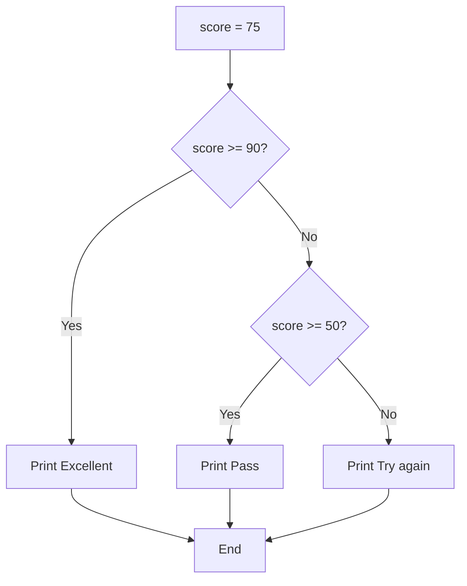

# 8. Operators and conditions

[Back to Python topics](../README.md)

Operators work with values. Conditions choose which block of code runs.

| Kind | Operators | Small example |
| --- | --- | --- |
| Arithmetic | `+`, `-`, `*`, `/`, `//`, `%`, `**` | `7 // 2` gives `3` |
| Comparison | `==`, `!=`, `<`, `<=`, `>`, `>=` | `5 > 2` gives `True` |
| Logic | `and`, `or`, `not` | `True and False` gives `False` |
| Membership | `in`, `not in` | `"a" in "cat"` gives `True` |

`/` divides; `//` rounds the division result down; `%` gives the remainder;
`**` raises a number to a power. `=` assigns a value, while `==` compares values.

## Example: choose one branch

Python checks conditions from top to bottom. Only the first matching branch runs.
Use four spaces to indent each block.

```python
score = 75
if score >= 90:
    print("Excellent")
elif score >= 50:
    print("Pass")
else:
    print("Try again")
```

Output:

```text
Pass
```

Run `index.py` in this folder to try this example.

## Flow diagram



## Truthiness

`False`, `None`, numeric zero, and empty strings or collections are false in a condition.
Nonempty collections are true, even if they contain `0` or `False`.

```python
items = []
if not items:
    print("Empty list")
```

Output:

```text
Empty list
```

**Common mistake:** writing `if score = 75:`. Use `if score == 75:` to compare.

## Extended lesson

**Learning goals:** Use short-circuit conditions and choose between if, conditional expressions, and pattern matching.

`and` and `or` evaluate from left to right and may skip the second operand. They return an operand, not necessarily a Boolean. This makes short-circuit guards useful, but it also means `value or default` replaces every false value, including valid zero.

Use if/elif for decisions with several actions. A conditional expression chooses between two values. Structural pattern matching (`match`, Python 3.10+) selects a case based on the shape or value of data. Cases are tried in order; `_` is the catch-all wildcard. Keep expressions readable with parentheses instead of relying on memorized precedence.

### Short-circuit a risky operation

The division is skipped because the first condition is false.

```python
denominator = 0
print(denominator != 0 and 10 / denominator > 1)
```

Output:

```text
False
```

### Choose a value

A conditional expression is compact when both branches are simple.

```python
temperature = 32
label = "Hot" if temperature >= 30 else "Cool"
print(label)
```

Output:

```text
Hot
```

### Match a command

Quoted text is a literal pattern. An unquoted name normally captures a value.

```python
command = "start"
match command:
    case "start":
        print("Running")
    case "stop":
        print("Stopped")
    case _:
        print("Unknown command")
```

Output:

```text
Running
```

### Understand negative floor division

Floor division rounds toward negative infinity; integer conversion of a float truncates toward zero.

```python
print(-7 // 2)
print(int(-7 / 2))
```

Output:

```text
-4
-3
```

## Practice and worked answer

1. Explain why `0 or 10` returns 10.
2. Preserve zero but use 10 when a value is None.

Try these before reading the answer.

<details>
<summary>Show the explanation and one solution</summary>

or returns the second operand when the first is false. An explicit None check expresses the intended default rule.

### One solution

This example runs independently.

```python
value = 0
result = 10 if value is None else value
print(result)
```

Output:

```text
0
```

</details>
