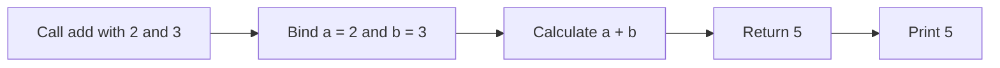

# 9. Functions

[Back to Python topics](../README.md)

A function is a reusable block of code. Define it with `def`, give it inputs
(parameters), and use `return` to send a result back to the caller.

## Example: return a result

```python
def add(a, b):
    return a + b

print(add(2, 3))
```

Output:

```text
5
```

Run `index.py` in this folder to try this example.

## Flow diagram



## Default and keyword arguments

A default is used when an argument is omitted. A keyword argument names the
parameter explicitly.

```python
def greet(name="friend"):
    return f"Hello, {name}"

print(greet())
print(greet(name="Maya"))
```

Output:

```text
Hello, friend
Hello, Maya
```

## Collect several arguments

`*args` collects positional arguments in a tuple. `**kwargs` collects keyword
arguments in a dictionary. The names `args` and `kwargs` are conventions.

```python
def show(*args, **kwargs):
    print(args)
    print(kwargs)

show(1, 2, name="Maya")
```

Output:

```text
(1, 2)
{'name': 'Maya'}
```

## Lambda: a small function expression

```python
double = lambda number: number * 2
print(double(4))
```

Output:

```text
8
```

Use `def` when a function needs several steps or a descriptive body.

**Common mistake:** expecting `print()` to return the printed value. A function
without an explicit `return` returns `None`. Also avoid mutable defaults such as
`items=[]`: the same list is reused between calls. Use `None` and create a new list
inside the function when needed.

## Extended lesson

**Learning goals:** Design small function contracts, control argument passing, and avoid shared mutable defaults.

A useful function has a clear contract: what inputs it accepts, what value it returns, and what errors it may raise. Prefer returning values from calculation functions so callers can print, store, or test them independently. Put I/O at the edges of a program.

Arguments are passed by assignment: a parameter becomes a local name referring to the supplied object. Rebinding a parameter does not rebind the caller's name, but mutating a shared object can be visible to the caller. Default expressions are evaluated when the function is defined, not on every call. The `/` marker makes earlier parameters positional-only; `*` makes later parameters keyword-only.

### Use a fresh default collection

None marks an omitted value; a new list is created for each such call.

```python
def add_item(item, items=None):
    if items is None:
        items = []
    items.append(item)
    return items

print(add_item("a"))
print(add_item("b"))
```

Output:

```text
['a']
['b']
```

### Require a clear call style

The separator makes discount an explicit named option.

```python
def price(amount, /, *, discount=0):
    return amount - discount

print(price(20, discount=3))
```

Output:

```text
17
```

### Return more than one result

Comma-separated return values form a tuple that callers can unpack.

```python
def bounds(values):
    return min(values), max(values)

low, high = bounds([8, 2, 5])
print(low, high)
```

Output:

```text
2 8
```

### Rebinding a parameter

The original list is not changed by assigning a new list to the parameter.

```python
def replace(items):
    items = [99]
    return items

original = [1]
print(replace(original))
print(original)
```

Output:

```text
[99]
[1]
```

## Practice and worked answer

1. Write a function that returns the square of a number.
2. Give it a one-line docstring and test two inputs.

Try these before reading the answer.

<details>
<summary>Show the explanation and one solution</summary>

Use return so the result can be reused; a docstring is the first string in the function body.

### One solution

This example runs independently.

```python
def square(number):
    """Return number multiplied by itself."""
    return number * number

print(square(3), square(-2))
```

Output:

```text
9 4
```

</details>
