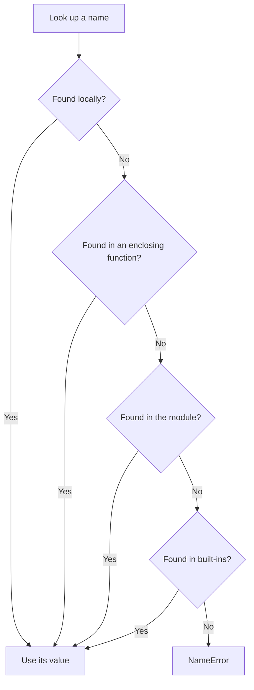

# Scope and LEGB

In ordinary function code, Python looks for a name in this order: **Local**, **Enclosing function**, **Global** (the module), then **Built-in**. This is called LEGB. A local name can hide a global name without changing it.

## Simple example

```python
color = "blue"

def show_color():
    color = "green"
    print(color)

show_color()
print(color)
```

## Output

```text
green
blue
```

## Flow diagram



## Common mistake

Reading a name and then assigning to it inside a function can raise `UnboundLocalError`: the assignment makes it local throughout that function unless declared `global` or `nonlocal`. Prefer passing values into the function and returning results when possible.

[Back to Core Language Mechanics](../README.md)

## Deeper understanding

Assignments inside a function normally make a name local throughout that function. This decision is not based on which branch happens to run. Reading such a name before a local value has been assigned raises UnboundLocalError; Python does not simply fall back to a global value.

An if or for block does not create a separate function-local scope. Comprehensions have their own scope for the iteration variable. Use global to rebind a module name and nonlocal to rebind an existing enclosing-function name. Prefer explicit parameters and return values when shared state is unnecessary.

### A block keeps the surrounding scope

The block does not create a separate local namespace.

```python
if True:
    label = "ready"
print(label)
```

Output:

```text
ready
```

### Comprehension variables stay local to the comprehension

The outer number binding survives.

```python
number = 10
squares = [number * number for number in range(3)]
print(squares)
print(number)
```

Output:

```text
[0, 1, 4]
10
```

## Practice

Why can a read followed by an assignment inside a function raise UnboundLocalError even when a global value exists?

<details>
<summary>Show the answer</summary>

The assignment marks the name as local throughout that function. If the read comes first, the local binding has no value yet. Pass the value in, return a new value, or deliberately declare the intended scope.

</details>
