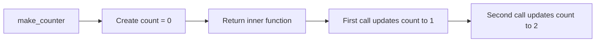

# Closures and `nonlocal`

A closure is an inner function that keeps access to names from its enclosing function. Use `nonlocal` when the inner function needs to assign to an existing name in an enclosing function.

## Simple example

```python
def make_counter():
    count = 0
    def next_count():
        nonlocal count
        count += 1
        return count
    return next_count

counter = make_counter()
print(counter(), counter())
```

## Output

```text
1 2
```

## Flow diagram



## Common mistake

Leaving out `nonlocal` before `count += 1` makes `count` local to `next_count`, causing `UnboundLocalError`. Merely reading the enclosing name does not need `nonlocal`.

[Back to Core Language Mechanics](../README.md)

## Deeper understanding

A closure preserves access to an enclosing binding, not necessarily a frozen copy of its value. This matters when several functions are created in a loop: they may all read the same loop variable when called later. Capture a value with a default argument when that is the desired behavior.

Each call to a factory function creates a separate enclosing environment. Functions returned from the same call can share that environment; functions returned from separate calls need not share state. nonlocal is required for rebinding an enclosing name, not for mutating an object reached through it.

### Capture loop values deliberately

Default arguments are evaluated when each function is created.

```python
actions = [lambda value=value: value for value in range(3)]
print([action() for action in actions])
```

Output:

```text
[0, 1, 2]
```

### Create independent closures

Each returned function retains its own enclosing amount.

```python
def make_adder(amount):
    def add(value):
        return value + amount
    return add

add_two = make_adder(2)
add_five = make_adder(5)
print(add_two(10), add_five(10))
```

Output:

```text
12 15
```

## Practice

Predict the result of [f() for f in [lambda: n for n in range(3)]]. How would you change it?

<details>
<summary>Show the answer</summary>

It produces [2, 2, 2] because all functions read the same final n binding. Use lambda n=n: n to capture each iteration's value.

</details>
