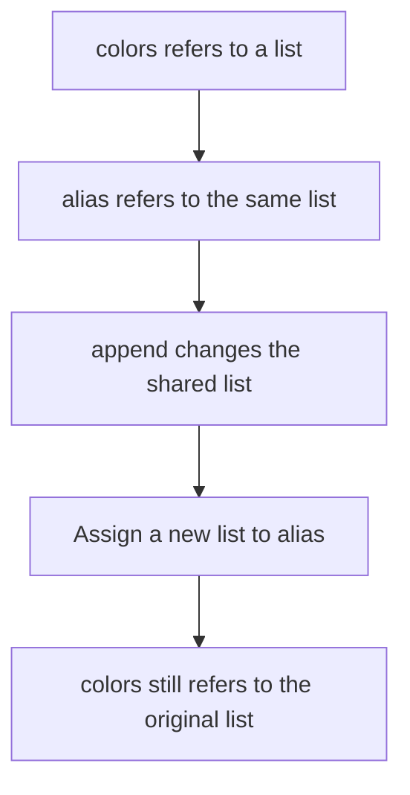

# Mutability and References

Variables refer to objects. Assigning a list to another variable gives both names the same list; it does not copy the list. A list is mutable, so its contents can change. Integers, strings, and tuples are immutable, although a tuple can contain a mutable object.

## Simple example

```python
colors = ["red"]
alias = colors
alias.append("blue")
print(colors)
alias = ["green"]
print(colors)
print(alias)
```

## Output

```text
['red', 'blue']
['red', 'blue']
['green']
```

## Flow diagram



## Common mistake

Expecting `alias = colors` to make an independent list. Use `colors.copy()` for a shallow copy; nested mutable values still need separate consideration.

[Back to Core Language Mechanics](../README.md)

## Deeper understanding

Mutation changes an object; rebinding changes which object a name refers to. Function parameters follow the same rule: mutating a supplied list can affect the caller, while rebinding the parameter does not rebind the caller's variable.

Be careful when using multiplication to build nested lists. Repeating one inner list repeats references, so several positions may share the same object. A comprehension creates a fresh inner list on each iteration. Augmented assignment can mutate a mutable object in place, so it is not universally interchangeable with ordinary addition plus rebinding.

### Create independent rows

Each iteration constructs a different inner list.

```python
rows = [[0] * 2 for _ in range(2)]
rows[0][0] = 9
print(rows)
```

Output:

```text
[[9, 0], [0, 0]]
```

### Observe in-place list extension

The existing list changes; both names still reach it.

```python
values = [1]
alias = values
values += [2]
print(alias)
print(values is alias)
```

Output:

```text
[1, 2]
True
```

## Practice

Why does [[0] * 2] * 2 change both rows when the first row is edited?

<details>
<summary>Show the answer</summary>

The outer multiplication duplicates references to the same inner list. Construct each row separately to avoid sharing.

</details>
