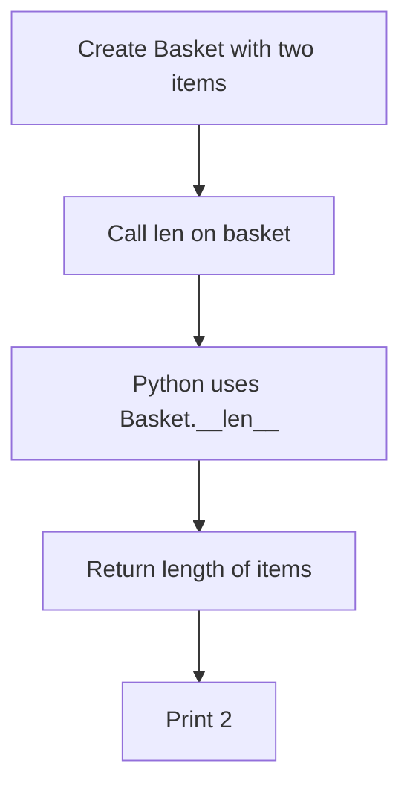

# 10.1 Special Methods

Special methods have names surrounded by double underscores, such as `__len__`. Python calls them to implement built-in operations on your objects.

Define `__len__` to make `len(object)` work. Its result must be a nonnegative integer.

## Simple example

```python
class Basket:
    def __init__(self, items):
        self.items = items

    def __len__(self):
        return len(self.items)


basket = Basket(["apple", "pear"])
print(len(basket))
```

## Output

```text
2
```

## Flow diagram



## Common mistake

Use the exact name `__len__`; a method named `length` will not automatically support `len()`. Prefer the built-in operation when using the object.

Run `python3 examples.py` from this folder.

[Back to Python's Data Model](../README.md)

## Deeper understanding

Special methods connect classes to Python syntax and built-in operations. __repr__ supplies a debugging representation, __str__ supplies a user-facing string, __iter__ makes objects iterable, and __call__ makes instances callable. Implement only operations that have a natural meaning for the object.

Comparison methods should return NotImplemented for unsupported counterpart types so Python can try the other operand's behavior. Hashable values need a stable hash consistent with equality. Defining equality for mutable objects requires care; using mutable values as dictionary keys is usually a poor design.

### Make an object callable

The instance stores configuration and behaves like a function.

```python
class Multiplier:
    def __init__(self, factor):
        self.factor = factor
    def __call__(self, value):
        return value * self.factor

print(Multiplier(3)(4))
```

Output:

```text
12
```

### Supply iteration behavior

Returning a fresh iterator makes repeated iteration possible.

```python
class Collection:
    def __init__(self, values):
        self.values = values
    def __iter__(self):
        return iter(self.values)

print(list(Collection([1, 2])))
```

Output:

```text
[1, 2]
```

## Practice

What invariant connects equality and hashing?

<details>
<summary>Show the answer</summary>

Objects that compare equal must have equal hashes. Hashes used as dictionary or set keys must remain stable while the objects are stored.

</details>
