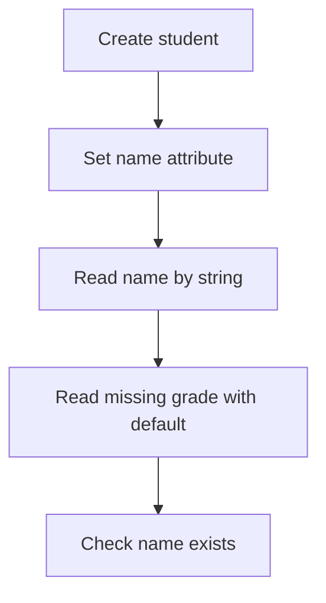

# 10.2 Attribute Access

`getattr(object, name)` reads an attribute using a string name. `setattr(object, name, value)` assigns it, and `hasattr(object, name)` checks whether attribute access succeeds.

Pass a third argument to `getattr` to supply a default for a missing attribute. Use ordinary dot notation when the name is already known in your code.

## Simple example

```python
class Student:
    pass


student = Student()
setattr(student, "name", "Maya")
print(getattr(student, "name"))
print(getattr(student, "grade", "Unknown"))
print(hasattr(student, "name"))
```

## Output

```text
Maya
Unknown
True
```

## Flow diagram



## Common mistake

`getattr(student, "grade")` raises `AttributeError` when `grade` is absent. Supply a default only when a missing value is expected.

Run `python3 examples.py` from this folder.

[Back to Python's Data Model](../README.md)

## Deeper understanding

Attribute lookup may involve class attributes, instance dictionaries, properties, and descriptors. getattr can invoke that behavior; it is not always a passive dictionary read. __getattr__ handles an attribute that ordinary lookup failed to find, while __getattribute__ intercepts ordinary attribute access more broadly and is easier to misuse.

Descriptors are objects defining methods such as __get__ and __set__ that participate in class attribute access. Properties are a familiar descriptor-based tool. Prefer properties for simple validation before implementing a custom descriptor. hasattr performs lookup and treats AttributeError as absence; other exceptions can still propagate.

### Provide a fallback for missing attributes

Unknown names still raise AttributeError so normal lookup semantics remain useful.

```python
class Settings:
    def __getattr__(self, name):
        if name == "theme":
            return "light"
        raise AttributeError(name)

print(Settings().theme)
print(hasattr(Settings(), "missing"))
```

Output:

```text
light
False
```

### Understand a simple descriptor

Reading the class-defined descriptor invokes its __get__ method.

```python
class Label:
    def __get__(self, instance, owner):
        return "ready"
class Job:
    status = Label()

print(Job().status)
```

Output:

```text
ready
```

## Practice

Why can hasattr execute application behavior?

<details>
<summary>Show the answer</summary>

It attempts attribute access, which can invoke properties, descriptors, or custom lookup methods.

</details>
