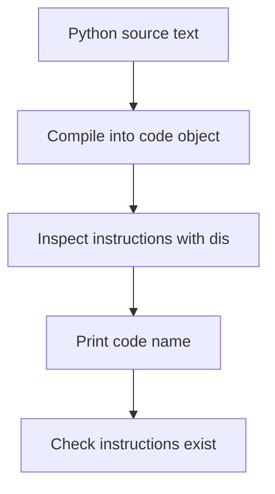

# 11.1 Bytecode and dis

CPython compiles source into code objects containing bytecode instructions. The `dis` module can inspect those instructions.

`compile()` creates a code object without executing it. This example inspects module-level code and checks that instructions exist. Exact bytecode details vary with the Python version and implementation. Run this example using CPython.

## Simple example

```python
import dis

code = compile("total = 2 + 3", "<example>", "exec")
instructions = list(dis.get_instructions(code))
print(code.co_name)
print(bool(instructions))
```

## Output

```text
<module>
True
```

## Flow diagram



## Common mistake

Do not depend on specific bytecode instructions in ordinary application code. Also, compiling an assignment does not perform the assignment.

Run `python3 examples.py` from this folder.

Reference: [Python's dis documentation](https://docs.python.org/3/library/dis.html).

[Back to Python Internals](../README.md)

## Deeper understanding

Python's language rules and a particular implementation's execution strategy are different levels. CPython compiles source into code objects containing bytecode. Exact instructions and optimization details change across versions; application correctness should not depend on them.

The ast module exposes source structure before bytecode execution. A syntax tree can support analysis or transformation, but compiling a code object does not execute it. Parsing a constrained literal is different from executing arbitrary source. Prefer structured data formats and validation at application boundaries.

### Inspect syntax structure

This inspects the source structure without executing the assignment.

```python
import ast
tree = ast.parse("total = 2 + 3")
print(type(tree.body[0]).__name__)
print(type(tree.body[0].value).__name__)
```

Output:

```text
Assign
BinOp
```

### Read a literal value

literal_eval handles literals rather than arbitrary calls, but untrusted huge inputs can still exhaust resources.

```python
import ast
value = ast.literal_eval("[1, 2, 3]")
print(value)
```

Output:

```text
[1, 2, 3]
```

## Practice

Why is a tutorial that hard-codes one disassembly listing fragile?

<details>
<summary>Show the answer</summary>

Bytecode is an implementation detail that changes between Python releases. Teach the concept and inspect the current interpreter instead.

</details>
