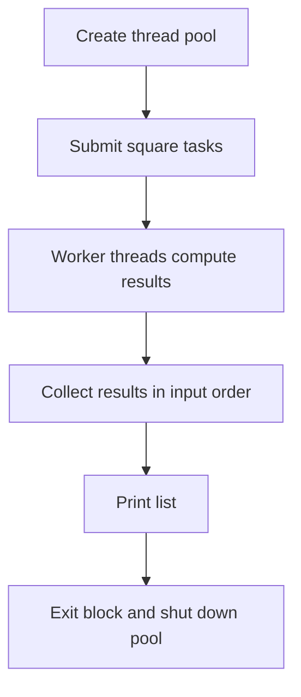

# 11.2 The GIL and Concurrency

Concurrency lets tasks make progress during overlapping periods; it does not promise simultaneous execution. `ThreadPoolExecutor` runs tasks using worker threads.

In CPython builds with the Global Interpreter Lock (GIL) enabled, only one thread executes Python bytecode at a time. Threads can still help with waiting for input/output, and some native operations release the GIL. Free-threaded CPython builds can run with the GIL disabled, so do not assume every build has the same restriction.

This tiny example shows the thread-pool API, not a speed improvement. `map()` returns results in the order of its inputs even if tasks finish in another order.

## Simple example

```python
from concurrent.futures import ThreadPoolExecutor


def square(number):
    return number * number


with ThreadPoolExecutor(max_workers=2) as pool:
    print(list(pool.map(square, [1, 2, 3])))
```

## Output

```text
[1, 4, 9]
```

## Flow diagram



## Common mistake

Do not assume threads make CPU-heavy Python code faster. Performance depends on the workload and Python build; use measurements for real optimization decisions.

Run `python3 examples.py` from this folder.

Reference: [Python's threading documentation](https://docs.python.org/3/library/threading.html#gil-and-performance-considerations).

[Back to Python Internals](../README.md)

## Deeper understanding

The GIL is an implementation/build property, not a universal promise of the Python language. In GIL-enabled CPython, it limits simultaneous Python-bytecode execution among threads sharing that interpreter. Threads can still help during I/O waits, and native extensions may release it. Free-threaded builds need different performance assumptions.

Independent of the GIL, programs must coordinate shared state and define task lifetime. Use locks for invariants and Events or queues for explicit signaling. A result that appears correct in one run does not establish thread safety. Measure real workloads before choosing threads or processes for performance.

### Signal readiness explicitly

An Event represents a signaling state rather than a timing guess.

```python
from threading import Event
ready = Event()
print(ready.is_set())
ready.set()
print(ready.wait(timeout=0))
```

Output:

```text
False
True
```

### Gather independent thread results

Independent results avoid shared mutable counters.

```python
from concurrent.futures import ThreadPoolExecutor
with ThreadPoolExecutor(max_workers=2) as pool:
    print(list(pool.map(len, ["cat", "python"])))
```

Output:

```text
[3, 6]
```

## Practice

Why is the GIL not sufficient to protect an application invariant involving several updates?

<details>
<summary>Show the answer</summary>

Other threads may run between steps, and implementations/builds differ. Protect the complete logical operation or avoid shared mutable state.

</details>
