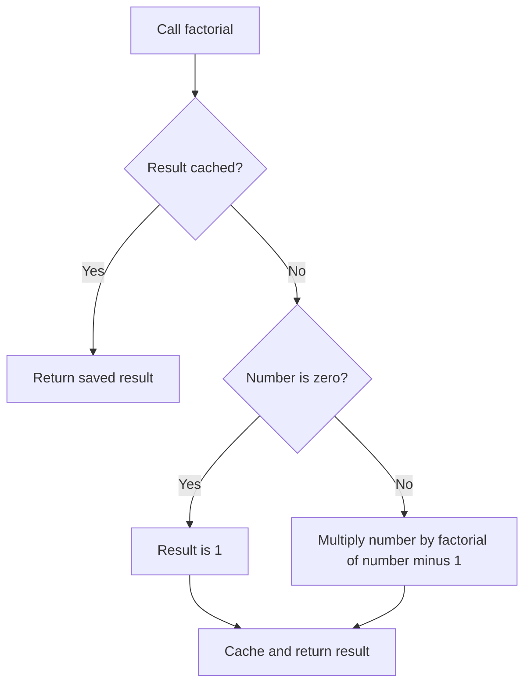

# Recursion and Caching

A recursive function calls itself with a smaller problem until it reaches a **base case**. `cache` remembers results for previously used arguments. This example computes factorial for nonnegative integers: `4! = 4 × 3 × 2 × 1`.

## Simple example

```python
from functools import cache

@cache
def factorial(number):
    if number == 0:
        return 1
    return number * factorial(number - 1)

print(factorial(4))
print(factorial(4))
```

## Output

```text
24
24
```

## Flow diagram



## Common mistake

Omitting a reachable base case causes repeated calls until `RecursionError`. This tiny example expects nonnegative integers; negative input never reaches zero. Cached arguments must also be hashable, and an unbounded cache can grow over time.

[Back to Functions and Patterns](../README.md)

## Deeper understanding

Recursion needs a reachable base case and a step that moves toward it. Python does not generally remove tail-recursive call frames, so deep recursion can reach the recursion limit. Iteration is often clearer for a long linear sequence.

Caching trades memory for repeated work. Arguments must be hashable, and the function's result should depend on the cache key rather than changing external state. Cache wrappers keep references to stored arguments and results. lru_cache limits the number of entries, while cache is unbounded. Inspect hit/miss information and clear stale caches deliberately.

### Use iteration for a factorial

The loop uses no growing call stack.

```python
result = 1
for number in range(1, 5):
    result *= number
print(result)
```

Output:

```text
24
```

### Inspect a bounded cache

The repeated call reuses the first result.

```python
from functools import lru_cache
@lru_cache(maxsize=2)
def square(number):
    return number * number

print(square(3), square(3))
info = square.cache_info()
print(info.hits, info.misses)
square.cache_clear()
```

Output:

```text
9 9
1 1
```

## Practice

Should a function that reads changing file contents be cached only by its path?

<details>
<summary>Show the answer</summary>

That key may return stale data. Include a reliable version in the key, invalidate deliberately, or avoid caching when freshness cannot be modeled.

</details>
