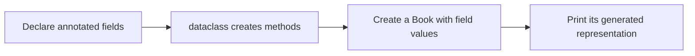

# Dataclasses

`@dataclass` creates useful methods, including an initializer and a readable representation, from annotated fields. It is useful for classes that mainly hold data. Type annotations describe expected types; they do not automatically check values at runtime.

## Simple example

```python
from dataclasses import dataclass

@dataclass
class Book:
    title: str
    pages: int

book = Book("Python Basics", 80)
print(book)
```

## Output

```text
Book(title='Python Basics', pages=80)
```

## Flow diagram



## Common mistake

Using `items: list = []` as a dataclass field default is rejected. To give each instance its own list, import `field` and use `items: list = field(default_factory=list)`.

[Back to Object-Oriented Python](../README.md)

## Deeper understanding

Dataclasses generate routine methods from declared fields, including initialization, representation, and equality by default. They reduce repetition but do not validate annotation types automatically. Use __post_init__ for validation or derived initialization after the generated initializer has assigned fields.

Use field(default_factory=...) for a fresh mutable default per instance. frozen=True blocks normal field assignment, but it is not deep immutability: a field may still refer to a mutable object. Equality compares declared fields for the same dataclass type by default; consider whether that expresses your domain.

### Use independent mutable defaults

The factory runs for each instance that omits the field.

```python
from dataclasses import dataclass, field
@dataclass
class Basket:
    items: list[str] = field(default_factory=list)

first, second = Basket(), Basket()
first.items.append("apple")
print(first.items, second.items)
```

Output:

```text
['apple'] []
```

### Create a changed copy

replace creates another instance instead of assigning into the original.

```python
from dataclasses import dataclass, replace
@dataclass(frozen=True)
class Point:
    x: int
    y: int

first = Point(1, 2)
second = replace(first, x=9)
print(first)
print(second)
```

Output:

```text
Point(x=1, y=2)
Point(x=9, y=2)
```

## Practice

Does frozen=True prevent mutation of a list stored in a field?

<details>
<summary>Show the answer</summary>

No. It blocks normal assignment to fields, not mutations inside objects those fields reference. Use immutable field values when that is the desired contract.

</details>
