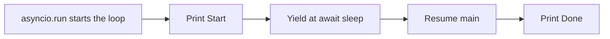

# Coroutines and `await`

An `async def` function creates a coroutine when called. `await` waits for an awaitable to finish and can let other tasks run while it waits. `asyncio.run()` starts the event loop for this standalone script. `sleep(0)` yields control without a timed delay.

## Simple example

```python
import asyncio

async def main():
    print("Start")
    await asyncio.sleep(0)
    print("Done")

asyncio.run(main())
```

## Output

```text
Start
Done
```

## Flow diagram



## Common mistake

Calling `main()` alone creates a coroutine but does not run its body. In a standalone script, use `asyncio.run(main())`. In an already running event loop, such as an async notebook, use `await main()` instead.

[Back to Asynchronous Python](../README.md)

## Deeper understanding

Calling async def creates a coroutine object; it does not start ordinary body execution immediately. Awaiting transfers control through the coroutine's execution. Cooperative concurrency requires operations that can suspend; adding async to CPU-bound code does not make it parallel or nonblocking.

asyncio.run is an entry point for a standalone program and manages an event loop. Do not call it inside an already running loop in the same thread. Use await there. A blocking library call inside a coroutine blocks its loop unless it is moved to an appropriate executor or replaced with an async implementation.

### Await a returned value

Awaiting gets the coroutine's result once its work completes.

```python
import asyncio
async def value():
    await asyncio.sleep(0)
    return 7
async def main():
    print(await value())
asyncio.run(main())
```

Output:

```text
7
```

### Offload a blocking-style function

The tiny function stands in for blocking I/O. Moving CPU work to a thread is not a general speedup.

```python
import asyncio
def load_name():
    return "Maya"
async def main():
    print(await asyncio.to_thread(load_name))
asyncio.run(main())
```

Output:

```text
Maya
```

## Practice

Why is time.sleep(1) inside async def different from await asyncio.sleep(1)?

<details>
<summary>Show the answer</summary>

time.sleep blocks the event-loop thread. asyncio.sleep suspends the task so the loop can run other ready tasks.

</details>
