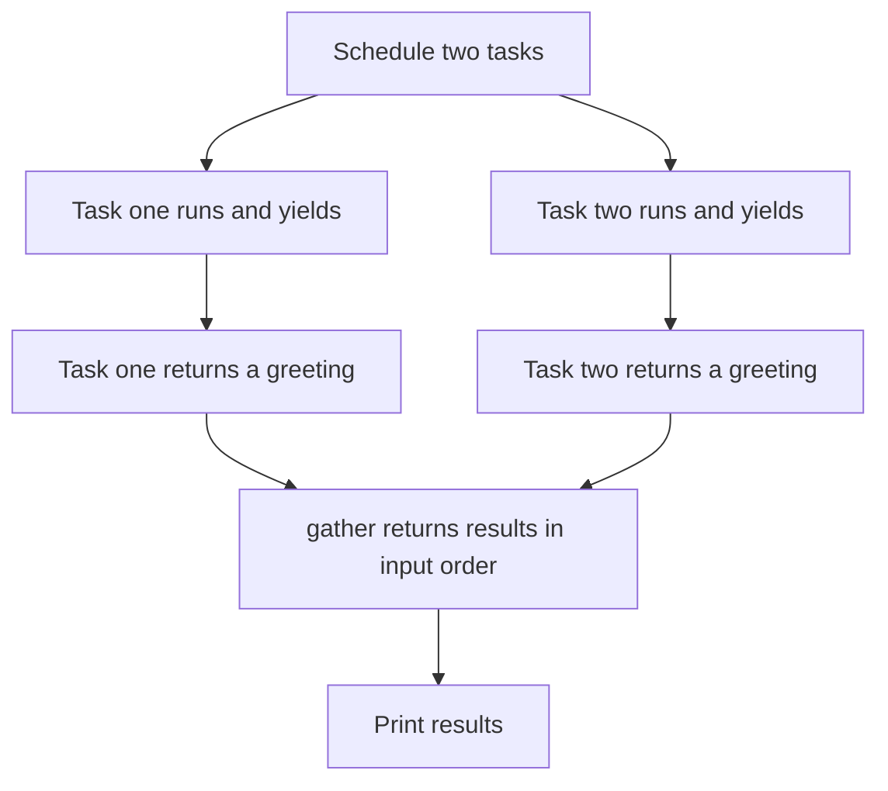

# Tasks and `gather`

`asyncio.create_task()` schedules a coroutine on the running event loop. `asyncio.gather()` waits for multiple awaitables and returns their results in input order. Tasks can make progress while another task is waiting; this does not make CPU-heavy Python work automatically parallel.

## Simple example

```python
import asyncio

async def greet(name):
    await asyncio.sleep(0)
    return f"Hi, {name}"

async def main():
    first = asyncio.create_task(greet("Mia"))
    second = asyncio.create_task(greet("Leo"))
    print(await asyncio.gather(first, second))

asyncio.run(main())
```

## Output

```text
['Hi, Mia', 'Hi, Leo']
```

## Flow diagram



## Common mistake

Awaiting one coroutine fully before starting the next makes those operations sequential. Schedule both first, or pass both coroutines to `gather()`.

[Back to Asynchronous Python](../README.md)

## Deeper understanding

Tasks schedule coroutine execution and carry results, exceptions, and cancellation state. Keep references when starting background work and define when it must finish. gather returns results in input order even if tasks complete in another order.

With default settings, gather propagates the first exception while other submitted work is not automatically cancelled merely because that exception was propagated. return_exceptions=True returns exceptions as result entries for inspection. Python 3.11+ TaskGroup provides a structured lifetime: child tasks are awaited on exit, and ordinary child failures cancel the remaining children and are reported as an exception group.

### Collect success and failure

Exception values must be inspected; returning them is not the same as recovery.

```python
import asyncio
async def success():
    return 1
async def failure():
    raise ValueError("bad")
async def main():
    results = await asyncio.gather(success(), failure(), return_exceptions=True)
    print(results[0], type(results[1]).__name__)
asyncio.run(main())
```

Output:

```text
1 ValueError
```

### Await a scheduled task

The task's lifetime is owned by the caller.

```python
import asyncio
async def work():
    await asyncio.sleep(0)
    return "done"
async def main():
    task = asyncio.create_task(work())
    print(await task)
    print(task.done())
asyncio.run(main())
```

Output:

```text
done
True
```

## Practice

Why should a program avoid launching tasks and discarding all references to them?

<details>
<summary>Show the answer</summary>

It loses a clear way to await completion, retrieve errors, and request cancellation. Define ownership and cleanup for every background activity.

</details>

## Structured task lifetime — Python 3.11+

TaskGroup waits for its children when the block exits. An ordinary child failure
cancels the remaining children; failures are reported together through exception
groups. Choose this policy when the jobs belong to one operation.

```python
import asyncio
async def work(number):
    await asyncio.sleep(0)
    return number * 2
async def main():
    async with asyncio.TaskGroup() as group:
        first = group.create_task(work(2))
        second = group.create_task(work(3))
    print(first.result(), second.result())
asyncio.run(main())
```

Output:

```text
4 6
```

[Official task-group reference](https://docs.python.org/3/library/asyncio-task.html#task-groups)
