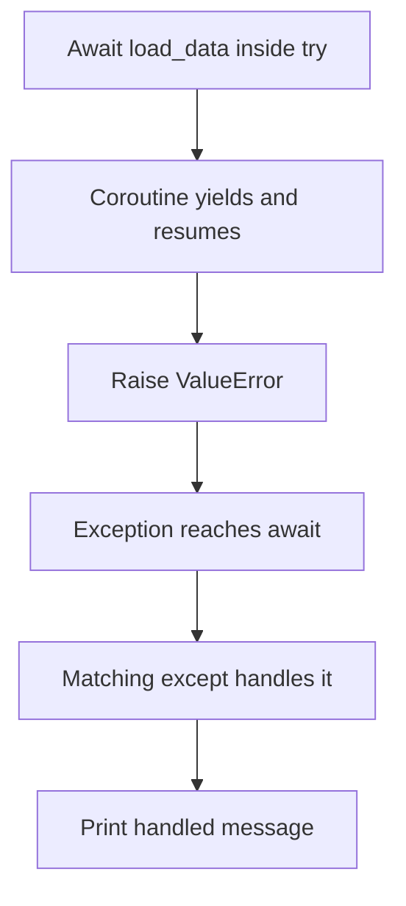

# Async Error Handling

An exception raised inside a coroutine reaches the code awaiting it. Put `try` and `except` around the `await` to handle an expected failure. This example uses a deliberate error, so its output stays predictable.

## Simple example

```python
import asyncio

async def load_data():
    await asyncio.sleep(0)
    raise ValueError("No data")

async def main():
    try:
        await load_data()
    except ValueError as error:
        print(f"Handled: {error}")

asyncio.run(main())
```

## Output

```text
Handled: No data
```

## Flow diagram



## Common mistake

Only surrounding `asyncio.create_task(...)` with `try` does not catch an error raised later inside that task. Keep a reference to the task and await it inside the `try` block.

[Back to Asynchronous Python](../README.md)

## Deeper understanding

Await propagates a coroutine's exception to its caller. Cancellation is a separate control signal: a task receives CancelledError at a suspension opportunity. Cleanup belongs in finally or an async context manager. If you catch CancelledError for cleanup, normally re-raise it so shutdown remains effective.

Timeouts need a documented policy. asyncio.wait_for can cancel the awaited operation on timeout and waits for cancellation to finish. A timeout does not prove an external side effect never happened. Recovery must distinguish a safe repeat from an operation whose completion is uncertain.

### Handle an already cancelled task

The owner observes cancellation by awaiting the task.

```python
import asyncio
async def work():
    await asyncio.sleep(0)
async def main():
    task = asyncio.create_task(work())
    task.cancel()
    try:
        await task
    except asyncio.CancelledError:
        print("Cancelled")
asyncio.run(main())
```

Output:

```text
Cancelled
```

### Run cleanup after a failure

The finally block runs before the exception reaches the caller.

```python
import asyncio
async def work():
    try:
        raise ValueError("bad")
    finally:
        print("Cleanup")
async def main():
    try:
        await work()
    except ValueError:
        print("Handled")
asyncio.run(main())
```

Output:

```text
Cleanup
Handled
```

## Practice

Why should timeout handling not automatically retry a payment or file mutation?

<details>
<summary>Show the answer</summary>

The caller may not know whether an external effect already occurred. A retry needs an idempotency or reconciliation strategy.

</details>

## Bound an operation with a timeout

This example uses an event that nobody sets and an immediate timeout. It demonstrates
the error path without a long wait. Real timeouts should follow the operation's contract.

```python
import asyncio
async def main():
    event = asyncio.Event()
    try:
        await asyncio.wait_for(event.wait(), timeout=0)
    except asyncio.TimeoutError:
        print("Timed out")
asyncio.run(main())
```

Output:

```text
Timed out
```

Timeout handling and cancellation cleanup should be tested separately from successful
completion. See the [official timeout documentation](https://docs.python.org/3/library/asyncio-task.html#timeouts).
