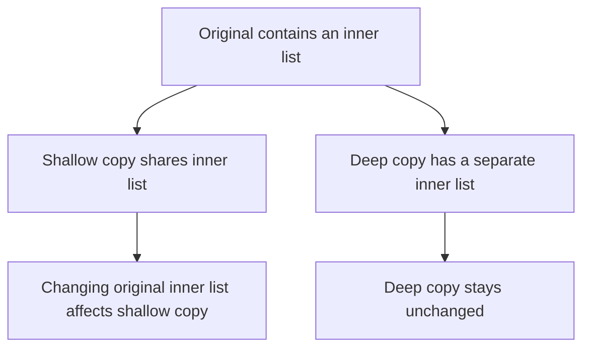

# Copying

A **shallow copy** creates a new outer container but shares its nested objects. `deepcopy()` recursively copies nested objects such as lists. Choose the depth of copying based on which data you need to change independently.

## Simple example

```python
from copy import deepcopy

original = [[1]]
shallow = original.copy()
deep = deepcopy(original)
original[0].append(2)
print(shallow)
print(deep)
```

## Output

```text
[[1, 2]]
[[1]]
```

## Flow diagram



## Common mistake

Expecting `original.copy()` to make nested lists independent. It copies only the outer list, so mutations to shared inner lists remain visible.

[Back to Advanced Data Handling](../README.md)

## Deeper understanding

Choose a copy depth according to which objects must change independently. A shallow copy replaces only the outer container. An immutable outer tuple may still contain mutable inner objects. Deep copying recursively handles many nested objects and uses memoization to track objects already seen.

Deep copy is not a general clone of operating-system resources or external state. Copying a socket or database connection is not equivalent to opening an independent resource. Often the best solution is a small immutable value object or an explicit reconstruction of the data that should be independent.

### A shallow copy shares nested state

A fresh dictionary still points to the same nested list.

```python
original = {"tags": ["python"]}
copy = original.copy()
copy["tags"].append("advanced")
print(original["tags"])
```

Output:

```text
['python', 'advanced']
```

### Independent flat lists

Appending changes the outer list, which is independent in this case.

```python
original = [1, 2]
copy = original.copy()
copy.append(3)
print(original)
print(copy)
```

Output:

```text
[1, 2]
[1, 2, 3]
```

## Practice

Would deep copying every input always improve a function?

<details>
<summary>Show the answer</summary>

No. It can add cost, change intended sharing, and fail for resource objects. Define ownership and copy only where independence is required.

</details>
