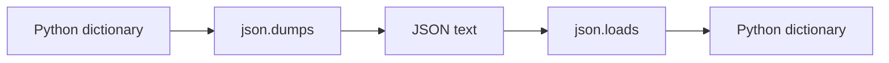

# JSON

JSON is a text format for sharing data. `json.dumps()` converts supported Python data into JSON text, and `json.loads()` converts JSON text back into Python data. The trailing `s` refers to a string; `dump()` and `load()` work with file objects.

## Simple example

```python
import json

text = json.dumps({"name": "Mia", "active": True})
print(text)
data = json.loads(text)
print(data["active"])
```

## Output

```text
{"name": "Mia", "active": true}
True
```

## Flow diagram



## Common mistake

Using `str(dictionary)` to create JSON. Python's string representation can contain single quotes and `True`, while JSON uses double quotes and `true`. Use `json.dumps()`.

[Back to Advanced Data Handling](../README.md)

## Deeper understanding

JSON represents objects, arrays, strings, numbers, booleans, and null. Python dictionaries and lists map naturally to JSON objects and arrays, but not every Python type has a direct representation. JSON object keys are strings; tuples usually become arrays and return as lists.

Parsing checks JSON syntax, not your application's schema. Validate the resulting outer type, required keys, and field values. Choose an explicit representation for dates, decimals, and custom classes. Avoid relying on Python-specific repr output as a portable data format.

### Observe a round-trip type change

The JSON format does not distinguish tuples from lists.

```python
import json
text = json.dumps((1, 2))
value = json.loads(text)
print(text)
print(type(value).__name__)
```

Output:

```text
[1, 2]
list
```

### Validate a field after parsing

Using exact int here deliberately rejects booleans, which are int subclasses.

```python
import json
data = json.loads('{"age": 20}')
if not isinstance(data, dict) or type(data.get("age")) is not int:
    raise ValueError("Expected an integer age")
print(data["age"])
```

Output:

```text
20
```

## Practice

Why can valid JSON still be invalid input to your function?

<details>
<summary>Show the answer</summary>

It may be an array where an object is required, omit keys, or contain fields with unacceptable types or values.

</details>
