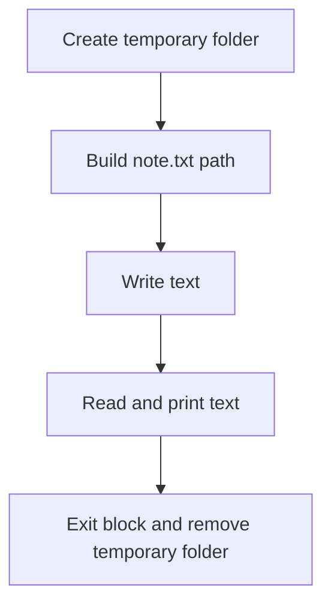

# 6.1 Paths and Files

`pathlib.Path` represents a file or folder path. Join path parts with `/`, then use `write_text()` or `read_text()` for small text files.

This example creates a temporary folder. Its file and folder are removed automatically when the `with` block ends.

## Simple example

```python
from pathlib import Path
from tempfile import TemporaryDirectory

with TemporaryDirectory() as folder:
    path = Path(folder) / "note.txt"
    path.write_text("Hello, Python!", encoding="utf-8")
    print(path.read_text(encoding="utf-8"))
```

## Output

```text
Hello, Python!
```

## Flow diagram



## Common mistake

Creating a `Path` does not create the file. Call a write method to create it; writing to an existing file replaces its contents.

Run `python3 examples.py` from this folder.

[Back to Files and the Standard Library](../README.md)

## Deeper understanding

A Path describes a location, not an open resource or proof of existence. Relative paths resolve against the current working directory. Joining with the / operator builds path components without manually choosing a platform separator.

Read and write text with an explicit encoding. Decide what should happen when the parent directory is absent or the target already exists. An existence check followed by an operation can race with another process; handle the operation's actual exceptions. Use temporary directories for disposable work and keep persistent data lifetimes explicit.

### Inspect path components

These lexical operations do not access the filesystem.

```python
from pathlib import Path
path = Path("reports") / "summary.csv"
print(path.name, path.suffix)
print(path.stem)
```

Output:

```text
summary.csv .csv
summary
```

### Change the extension

with_suffix returns a new path; it does not rename a file.

```python
from pathlib import Path
path = Path("report.txt")
print(path.with_suffix(".md"))
```

Output:

```text
report.md
```

## Practice

Does Path('notes.txt') create a file, and where does a relative path point?

<details>
<summary>Show the answer</summary>

Constructing a Path creates no file. A relative filesystem operation is resolved against the process working directory.

</details>
