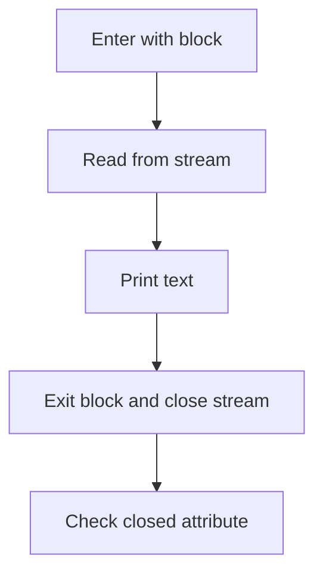

# 6.2 Context Managers

A context manager defines what happens when a `with` block starts and finishes. File context managers close their resource on exit, including when an exception leaves the block.

`StringIO` behaves like a text file stored in memory, so this example needs no disk file.

## Simple example

```python
from io import StringIO

with StringIO("Hello!") as stream:
    print(stream.read())

print(stream.closed)
```

## Output

```text
Hello!
True
```

## Flow diagram



## Common mistake

Do not read from the stream after its `with` block. The variable still exists, but the stream is closed.

Run `python3 examples.py` from this folder.

[Back to Files and the Standard Library](../README.md)

## Deeper understanding

The context-manager protocol defines setup and exit around a with block. __enter__ provides the value bound after as; __exit__ receives exception information. Returning a true value from __exit__ can suppress an exception, which should be a deliberate policy.

contextlib.contextmanager turns a generator with one yield into a context manager. Put cleanup in finally so it runs even when the block raises. ExitStack is useful when the number of resources is decided at runtime. Resource lifetime and variable scope are separate: the name may remain after the resource is closed.

### Build a small context manager

The code around yield supplies setup and guaranteed block-exit cleanup.

```python
from contextlib import contextmanager
@contextmanager
def session():
    print("Open")
    try:
        yield "ready"
    finally:
        print("Close")

with session() as value:
    print(value)
```

Output:

```text
Open
ready
Close
```

### Close several dynamic resources

ExitStack tracks exits for resources entered through it.

```python
from contextlib import ExitStack
from io import StringIO
with ExitStack() as stack:
    streams = [stack.enter_context(StringIO(text)) for text in ["a", "b"]]
    print([stream.read() for stream in streams])
print(all(stream.closed for stream in streams))
```

Output:

```text
['a', 'b']
True
```

## Practice

Why should cleanup after yield be placed in finally?

<details>
<summary>Show the answer</summary>

An exception from the with block is thrown into the generator at yield. finally ensures cleanup executes while that exception propagates.

</details>
