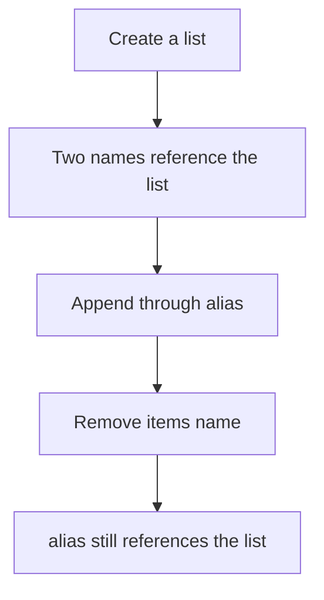

# 7.1 References and Garbage Collection

Variables are names that refer to objects. Assigning a list to another name shares that same list; it does not copy the list.

`del` removes a name, not every reference to its object. Python manages unused objects automatically. CPython normally uses reference counting and a cyclic garbage collector; collection details differ across implementations, so do not depend on exact cleanup timing.

## Simple example

```python
items = [1, 2]
alias = items
alias.append(3)
print(items)
del items
print(alias)
```

## Output

```text
[1, 2, 3]
[1, 2, 3]
```

## Flow diagram



## Common mistake

Do not expect `alias = items` to create an independent list. Use `items.copy()` for a shallow copy; nested objects are still shared.

Run `python3 examples.py` from this folder.

[Back to Memory and Performance](../README.md)

## Deeper understanding

Reachability determines whether objects remain needed. Caches, global collections, closures, and callbacks can keep objects alive unintentionally. Deleting one name removes only that reference; other references may still keep the object reachable.

CPython uses reference counting together with cyclic garbage collection, with details varying by build and version. Other implementations can use different strategies. Do not use object-finalization timing to manage files or locks. Weak references observe some objects without retaining them, but not every built-in type supports weak references.

### Observe an object weakly

The strong item binding keeps this demonstration deterministic.

```python
import weakref
class Item:
    pass
item = Item()
reference = weakref.ref(item)
print(reference() is item)
```

Output:

```text
True
```

### Remove a container reference

The kept name still refers to the first inner list.

```python
items = [[1], [2]]
kept = items[0]
items.clear()
print(items)
print(kept)
```

Output:

```text
[]
[1]
```

## Practice

Why might an unbounded cache increase memory even when local variables disappear?

<details>
<summary>Show the answer</summary>

The cache retains references to keys and results. Local scope exit does not remove those independent references.

</details>
