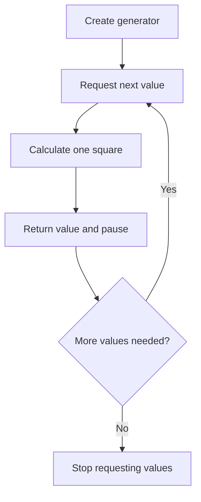

# 7.2 Generators and Memory

A generator produces values only when requested. A generator expression can avoid building a complete list of results in advance.

Generators keep their own state, and any referenced data still takes memory. Converting a generator to a list stores all its remaining results.

## Simple example

```python
squares = (number * number for number in range(1, 4))
print(next(squares))
print(next(squares))
print(next(squares))
```

## Output

```text
1
4
9
```

## Flow diagram



## Common mistake

A generator is consumed as you iterate. A fourth `next(squares)` here raises `StopIteration`; create a new generator to start again.

Run `python3 examples.py` from this folder.

[Back to Memory and Performance](../README.md)

## Deeper understanding

Generators avoid building all results at once, but they still retain their current state and referenced inputs. A generator over an existing huge list does not eliminate that list. Materializing list(generator) stores every remaining result and consumes the generator.

Measure representative code before optimizing. timeit helps compare small operations; cProfile locates where time is spent; tracemalloc helps investigate Python memory allocations. Timing depends on workload and environment, so avoid exact speed claims from tiny examples. sys.getsizeof is shallow and is not the full memory footprint of a graph of objects.

### Consume only a prefix

The remaining results have not been materialized.

```python
from itertools import islice
squares = (n * n for n in range(1000000))
print(list(islice(squares, 3)))
print(next(squares))
```

Output:

```text
[0, 1, 4]
9
```

### Short-circuit a stream

any stops as soon as a truthy value answers the question.

```python
def values():
    yield 0
    yield 1
    raise RuntimeError("Should not be reached")

print(any(values()))
```

Output:

```text
True
```

## Practice

Why can changing a comprehension to a generator fail to reduce memory?

<details>
<summary>Show the answer</summary>

The consumer may immediately build a list, or the generator may keep a large source collection alive. Examine the full processing chain.

</details>
