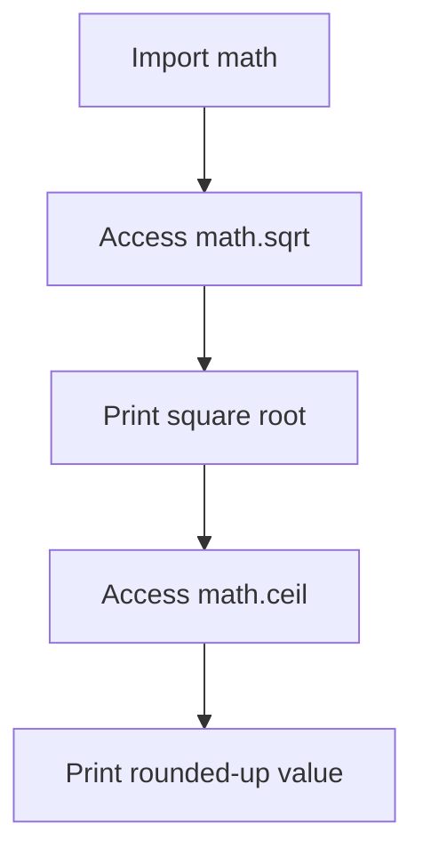

# 8.1 Imports and Modules

A module groups related code. `import math` makes the standard library's `math` module available under the name `math`.

Use dot notation to access its functions. The standard library comes with Python, so this example needs no extra package.

## Simple example

```python
import math

print(math.sqrt(16))
print(math.ceil(2.3))
```

## Output

```text
4.0
3
```

## Flow diagram



## Common mistake

After `import math`, write `math.sqrt(16)`, not `sqrt(16)`. Only `from math import sqrt` binds `sqrt` directly in your current module.

Run `python3 examples.py` from this folder.

[Back to Modules](../README.md)

## Deeper understanding

Import first finds and initializes a module if necessary, then binds a name in the importing scope. Python usually reuses the object in sys.modules within that process. A from import binds a particular attribute to a local name; it does not create a live alias that follows later rebinding of the module attribute.

Modules should have focused responsibilities and avoid expensive effects during import. Circular imports may expose partially initialized modules. Move truly shared definitions to a separate module or reconsider dependency direction. Relative imports depend on package context, so prefer running package entry points with python -m.

### Inspect the import cache

The cache contains the module object used by the importing code.

```python
import math, sys
print(sys.modules["math"] is math)
```

Output:

```text
True
```

### Import dynamically when a name is data

Dynamic import is useful for controlled plugin selection, not a replacement for ordinary imports everywhere.

```python
from importlib import import_module
module = import_module("math")
print(module.isqrt(20))
```

Output:

```text
4
```

## Practice

How can a file named json.py in your project interfere with import json?

<details>
<summary>Show the answer</summary>

Module search may find the local file first, hiding the standard-library module. Choose names that do not unintentionally shadow dependencies.

</details>
