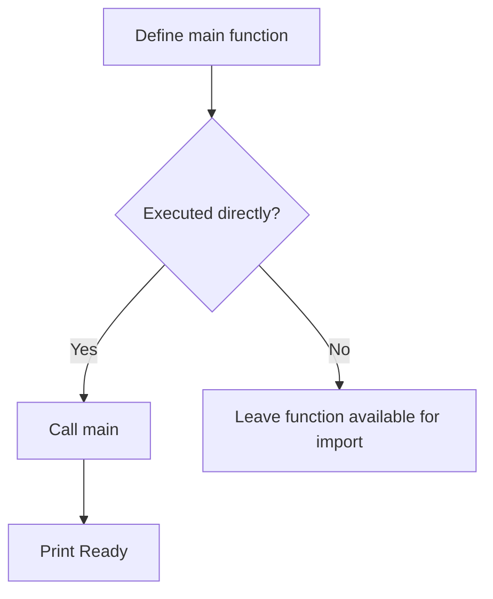

# 8.2 The Main Guard

When Python executes a file directly, it sets that file's `__name__` to `"__main__"`. When another module imports it, `__name__` is the module's import name.

The main guard lets you define reusable functions while calling your script's entry function only during direct execution. Importing this example defines `main()` without printing anything. The output below is for direct execution.

## Simple example

```python
def main():
    print("Ready")


if __name__ == "__main__":
    main()
```

## Output

```text
Ready
```

## Flow diagram



## Common mistake

Code outside the guard still runs during import. Put script actions inside `main()` and call it under the guard.

Run `python3 examples.py` from this folder.

[Back to Modules](../README.md)

## Deeper understanding

A module can define reusable behavior and also act as a command-line entry point. The main guard chooses whether to invoke that entry behavior. It does not stop other top-level statements from running during import, so place actions inside functions rather than scattering them around the module.

For a package, __main__.py can define what python -m package runs. In a command-line application, main can return an integer exit status and the guard can use raise SystemExit(main()). Keep argument parsing at the boundary so the underlying operations remain easy to call in tests.

### Keep main callable

A test can call behavior directly without emulating a terminal.

```python
def main(values):
    return sum(values)

print(main([2, 3]))
```

Output:

```text
5
```

### Separate a return code from output

A real script could pass the returned code to SystemExit.

```python
def main(valid):
    if not valid:
        return 2
    return 0

print(main(True), main(False))
```

Output:

```text
0 2
```

## Practice

Does the main guard prevent an import-time print above the guard?

<details>
<summary>Show the answer</summary>

No. Import still executes top-level statements. The guard protects only the code nested inside its block.

</details>
