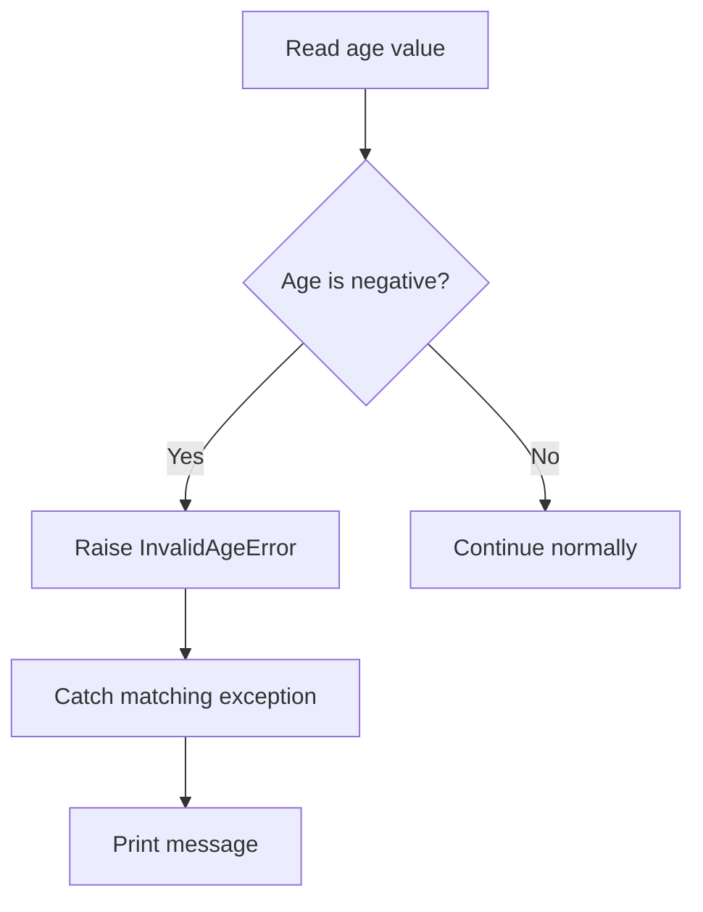

# 9.1 Custom Exceptions

A custom exception is a class derived from `Exception` or one of its subclasses. Give it a meaningful name so callers can handle that specific failure.

Here, `InvalidAgeError` is also a `ValueError` because it represents an unacceptable value.

## Simple example

```python
class InvalidAgeError(ValueError):
    pass


try:
    age = -1
    if age < 0:
        raise InvalidAgeError("Age cannot be negative")
except InvalidAgeError as error:
    print(error)
```

## Output

```text
Age cannot be negative
```

## Flow diagram



## Common mistake

Do not raise a plain string such as `raise "Invalid age"`. Raise an exception instance or exception class.

Run `python3 examples.py` from this folder.

[Back to Advanced Error Handling](../README.md)

## Deeper understanding

Custom exceptions let callers handle a meaningful failure without inspecting message text. Derive from Exception or an appropriate subclass, and design a small hierarchy only when distinct recovery policies need it. Exception messages should help a person; structured attributes can carry data for code.

Raise the exception where a rule is violated. Catch it where a caller can recover or translate the failure at a boundary. Do not use exceptions for every ordinary branch, but do not replace real failures with ambiguous None values unless that absence is part of the function's contract.

### Carry structured error data

Callers can inspect item_id without parsing the message.

```python
class MissingItemError(LookupError):
    def __init__(self, item_id):
        self.item_id = item_id
        super().__init__(f"Missing item {item_id}")

try:
    raise MissingItemError(7)
except MissingItemError as error:
    print(error.item_id)
    print(error)
```

Output:

```text
7
Missing item 7
```

### Catch a family of errors

The common base supports one shared boundary handler.

```python
class AppError(Exception):
    pass
class InvalidInput(AppError):
    pass
try:
    raise InvalidInput("Bad value")
except AppError as error:
    print(type(error).__name__)
```

Output:

```text
InvalidInput
```

## Practice

Why is catching an error by checking a substring of str(error) fragile?

<details>
<summary>Show the answer</summary>

Messages may change for clarity or localization. Catch the exception type and use documented attributes instead.

</details>
