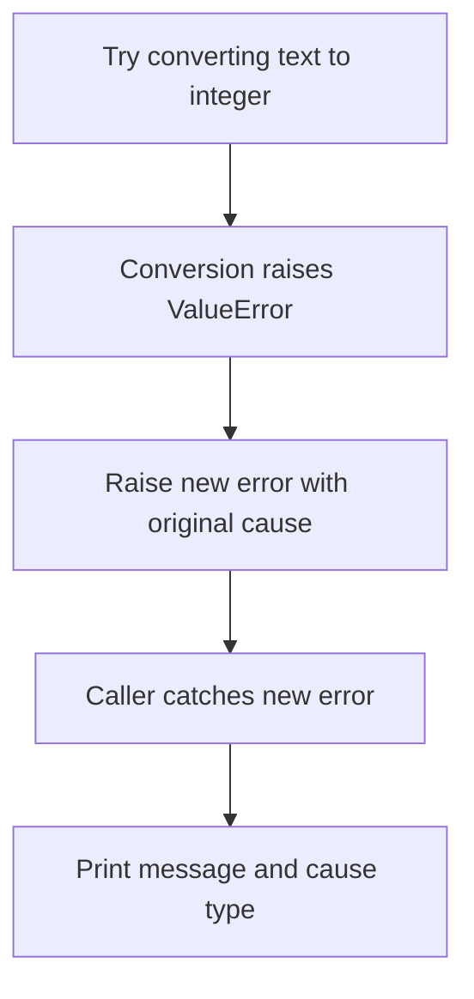

# 9.2 Exception Chaining

`raise NewError(...) from original_error` explicitly records why a new exception happened. The new exception's `__cause__` refers to the original exception.

Chaining lets a function report a useful message without losing the underlying failure.

## Simple example

```python
def read_age(text):
    try:
        return int(text)
    except ValueError as error:
        raise ValueError("Age must be a number") from error


try:
    read_age("hello")
except ValueError as error:
    print(error)
    print(type(error.__cause__).__name__)
```

## Output

```text
Age must be a number
ValueError
```

## Flow diagram



## Common mistake

Using `from None` hides the original context in the displayed traceback. Use `from error` when callers need to see the cause.

Run `python3 examples.py` from this folder.

[Back to Advanced Error Handling](../README.md)

## Deeper understanding

Exception chaining preserves causality when a lower-level failure is translated into a higher-level contract. raise NewError(...) from original sets __cause__ explicitly. An exception raised while handling another also retains implicit context. A bare raise re-raises the currently handled exception.

Use translation when the new exception gives callers a useful abstraction, such as converting a parser failure into a configuration error. Do not repeatedly wrap at every layer without adding meaning. from None suppresses the previous context in the displayed traceback; it does not mean the previous exception never existed.

### Translate a parsing error

The caller receives the domain error while diagnostics retain the cause.

```python
class ConfigError(Exception):
    pass
try:
    try:
        int("bad")
    except ValueError as error:
        raise ConfigError("Invalid port") from error
except ConfigError as error:
    print(error)
    print(type(error.__cause__).__name__)
```

Output:

```text
Invalid port
ValueError
```

### Inspect implicit context

Explicit from is not required for implicit context to be retained.

```python
try:
    try:
        int("bad")
    except ValueError:
        raise RuntimeError("Cannot continue")
except RuntimeError as error:
    print(type(error.__context__).__name__)
```

Output:

```text
ValueError
```

## Practice

When should a handler use bare raise rather than create a new exception?

<details>
<summary>Show the answer</summary>

When it needs to perform local work such as cleanup but wants the same failure to continue without translating its meaning.

</details>
