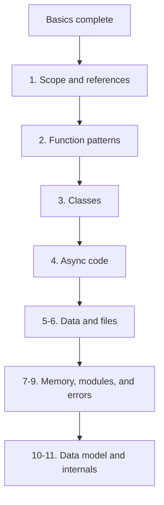

# Advanced Python concepts

[Back to all Python topics](../README.md)

Finish the basics first, especially functions, exceptions, and classes. Then study
type hints and testing. Each of these 27 lessons includes multiple short examples,
expected outputs, a flow diagram, deeper explanations, and a practice answer.
The expanded material is in Markdown; existing examples.py files cover the original snippet.

| Category | Short lessons |
| --- | --- |
| [1. Core language mechanics](1-core-language-mechanics/README.md) | Scope and LEGB; closures and `nonlocal`; mutability and references |
| [2. Functions and patterns](2-functions-and-patterns/README.md) | Higher-order functions; decorators; recursion and caching |
| [3. Object-oriented Python](3-object-oriented-python/README.md) | Inheritance and `super`; properties; dataclasses |
| [4. Asynchronous Python](4-asynchronous-python/README.md) | Coroutines and `await`; tasks and `gather`; async errors |
| [5. Advanced data handling](5-advanced-data-handling/README.md) | Copying; JSON; iterators and generators |
| [6. Files and standard library](6-files-and-standard-library/README.md) | Paths and files; context managers |
| [7. Memory and performance](7-memory-and-performance/README.md) | References and garbage collection; generators and memory |
| [8. Module systems](8-module-systems/README.md) | Imports and modules; the main guard |
| [9. Advanced error handling](9-advanced-error-handling/README.md) | Custom exceptions; exception chaining |
| [10. Python data model](10-python-data-model/README.md) | Special methods; attribute access |
| [11. Python internals](11-python-internals/README.md) | Bytecode and `dis`; GIL and concurrency |

## Flow diagram



## Run an example

From the workspace containing `python/`:

```bash
python3 "python/Advanced concepts/5-advanced-data-handling/5.2-json/examples.py"
```

No package installation is required. File examples use temporary files or
in-memory streams. Concurrency examples use tiny local tasks with fixed output.
CPython-specific implementation details are identified in the internals lessons.

## Recommended sequence

Study categories 1, 2, 3, and 5 first. Continue with files and context managers (6),
modules (8), and exception design (9). Then study async (4), memory (7), the data
model (10), and internals (11). Category numbers preserve the original structure.
The TaskGroup extension requires Python 3.11+; other core examples use Python 3.10-compatible syntax.

Continue with [concurrency](../25.concurrency-and-parallelism/README.md),
[architecture](../26.design-and-architecture/README.md), and
[guided projects](../PRACTICE_PROJECTS.md).
