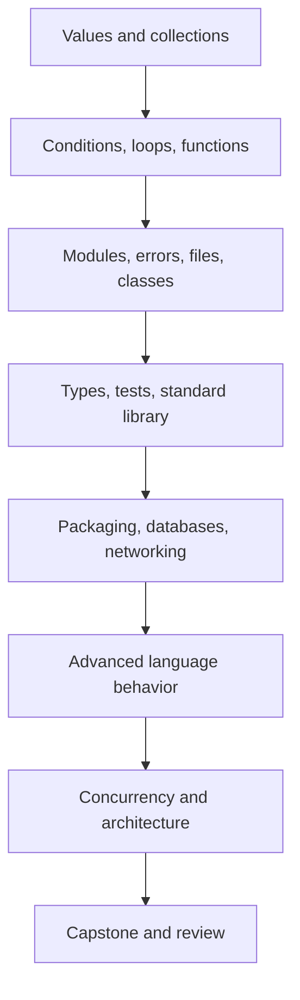

# Python learning path: beginner to advanced

[Course home](README.md) · [Projects](PRACTICE_PROJECTS.md) · [Review questions](REVIEW_QUESTIONS.md)

Work by milestones rather than a fixed number of days. Read an explanation, predict
the example's output, run it, change one input, and solve the exercise before opening
its answer. Write down the rule that explains any unexpected result.

The core examples use Python 3.10-compatible syntax. Python 3.11+ is needed for the
explicitly labelled TaskGroup example. Use a supported Python 3 release for your
own projects. CPython-specific internals are identified as such.

## Stage 1: values and expressions

Read [introduction](1.introduction/README.md), [variables](2.variables/README.md),
[types](3.datatypes/README.md), [conversion](4.type-casting/README.md),
[collections](5.data-structure/README.md), and [comparisons](6.equality-comparisons/README.md).

Explain assignment in your own words: a name refers to an object. Distinguish a
string from a number, a list from a dictionary, and equality from identity. Predict
whether an operation creates a new value or changes an existing object.

**Checkpoint:** convert a text price, combine it with a quantity, and display a
total. Choose appropriate collections for ordered tasks, unique tags, and name-to-score
lookups. Explain why `bool("False")` is true and why `is` is not numeric equality.

## Stage 2: decisions and reusable behavior

Read [conditions](8.operators-and-conditions/README.md) before
[loops](7.loops-and-iterations/README.md), then
[functions](9.functions/README.md) and [strings and comprehensions](10.strings-and-comprehensions/README.md).

The folder numbers preserve the original study notes, so numerical order is not
always the recommended reading order. Learn how control reaches each statement,
why a loop terminates, and how a function returns a reusable value.

**Checkpoint:** solve the score-summary project without global state. Handle an
empty input explicitly. Use a loop first, then consider a comprehension only if it
makes the transformation clearer. Explain the difference between print and return.

## Stage 3: complete small programs

Read [modules](11.modules-and-packages/README.md),
[exceptions](12.errors-and-exceptions/README.md), [files](13.file-handling/README.md),
[classes](14.classes-and-objects/README.md), and [command-line programs](15.input-output-and-cli/README.md).

Separate the program's calculation from reading and writing. Define what invalid
input means, choose an exception policy, and close resources reliably. Use a class
when shared state or an interface makes it useful; keep simple calculations as functions.

**Checkpoint:** implement the task-list project. Invalid input should produce a
useful response; an unexpected programming error should remain visible. Explain
what runs when a module is imported and what belongs inside a main function.

## Stage 4: reliable practical Python

Read these chapters in order:

1. [Type hints](16.type-hints/README.md): describe contracts and narrow optional values.
2. [Standard-library tools](17.standard-library-tools/README.md): count, group, and handle dates.
3. [Regular expressions](18.regular-expressions/README.md): recognize constrained text patterns.
4. [Testing and debugging](19.testing-and-debugging/README.md): check behavior and investigate failures.
5. [Logging and configuration](20.logging-and-configuration/README.md): validate settings and record events.
6. [Environments and packaging](21.environments-and-packaging/README.md): isolate and declare dependencies.
7. [SQLite](22.databases-and-sqlite/README.md): query data and define transactions.
8. [HTTP fundamentals](23.http-and-networking/README.md): separate transport, parsing, and validation.
9. [Algorithms](24.algorithms-and-complexity/README.md): reason about time and memory growth.

**Checkpoint:** complete the expense-summary and contact-database projects. Include
normal, boundary, and invalid cases. Explain why type hints do not validate JSON
and why an exception handler should have a specific recovery purpose.

## Stage 5: advanced language behavior

Open the [advanced index](Advanced%20concepts/README.md). Study scope and references,
function patterns, object-oriented behavior, and data handling before the more
specialized implementation topics. The index groups the recommended sequence.

**Checkpoint:** explain a late-binding closure, a shared mutable default, a shallow
copy of nested data, and a consumed generator. Implement one decorator that preserves
arguments and return values. Explain what a property or descriptor does during access.

## Stage 6: concurrency and design

Complete the advanced async lessons, then read
[concurrency](25.concurrency-and-parallelism/README.md) and
[program design](26.design-and-architecture/README.md).

Decide which component owns a task, a resource, or a mutable value. Distinguish
waiting work from CPU work. Use cancellation and cleanup deliberately. Keep external
dependencies replaceable so tests can exercise behavior without live services.

**Checkpoint:** finish the bounded-job-runner project. Explain why task creation,
completion order, result order, and parallel execution are different concepts.
Show how your design handles an individual failure and caller cancellation.

## Course flow

## Completion standard

You are ready to move beyond this course when you can build and explain a small
program with a clear interface, validated inputs, meaningful tests, reliable cleanup,
and documented dependencies. You should also know which details to look up rather
than guessing: library contracts, platform behavior, and implementation-specific performance.

Use [review questions](REVIEW_QUESTIONS.md) to locate gaps. Returning to a prerequisite
is part of the learning path, not a reason to memorize a solution.
